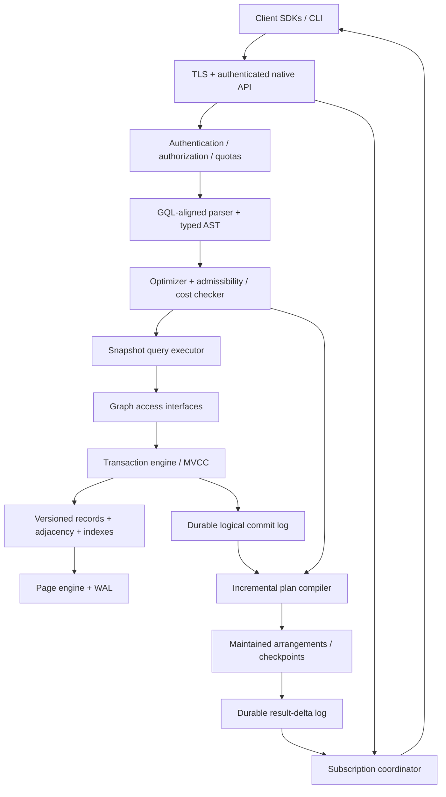

# pizzlydb — Architecture & Implementation Guide

**Status:** Target-state specification
**Audience:** Maintainers, implementers, reviewers, SDK authors, and operators
**Implementation language:** Rust (2024 edition)
**Primary implementation form:** Open-source, self-hostable database with a managed-service-ready operational model
**Document role:** Architectural source of truth; changes to normative behavior require an ADR/RFC
**Related records:** [ADR index](../adr/README.md), [RFC index](../rfcs/README.md), [roadmap](../roadmap/README.md)

> **Mission:** Build a transactional, graph-native operational database that continuously maintains supported graph-query results and delivers durable, resumable subscriptions as first-class database functionality.

This document defines the intended system, interfaces, invariants, delivery phases, and quality gates. Statements marked **MUST**, **SHOULD**, and **MAY** are normative requirements, recommendations, and options, respectively. The milestones are an implementation sequence, not a historical account or a delivery-date commitment.

---

## 1. Product contract

### 1.1 What pizzlydb is

pizzlydb is a **reactive property-graph database** designed for applications whose entities, relationships, and derived answers change frequently. It combines:

1. **Native graph operations:** labeled nodes, typed directed edges, properties, indexed adjacency traversal, graph-pattern queries.
2. **Operational transactions:** atomic multi-entity writes, snapshot-consistent reads, integrity constraints, crash durability, and an explicit isolation contract.
3. **Reactive computation:** incrementally maintained results for an explicitly supported query subset, including edge insertions and deletions.
4. **Durable subscriptions:** initial consistent results followed by ordered result deltas, reconnect/replay, gap detection, and backpressure.
5. **Usable platform:** documented protocol, Rust-first SDK, secure multi-tenant boundaries, backups, observability, and reproducible operations.

**Principal differentiator:** maintaining and delivering *query-result changes* over a mutable transactional graph, rather than merely sending raw node/edge mutations.

### 1.2 Target workloads

- Access-control and entitlement graphs with changing memberships and relationships.
- Live dependency graphs: service topology, assets, workflows, and collaborative state.
- Fraud/risk patterns involving bounded neighborhoods and frequently changing edges.
- Realtime operational applications that require continuously updated relationship-driven views.
- Knowledge and agent-state graphs where provenance, references, and updates matter; vector similarity is not a prerequisite.

### 1.3 Deliberate non-goals for the core system

- An unrestricted, fully standards-compliant GQL implementation in the first release.
- Arbitrary unbounded path enumeration or fully dynamic transitive closure as an initial subscription feature.
- A graph analytics/data-warehouse engine optimized for whole-graph scans.
- A built-in distributed message broker or a guarantee of exactly-once network delivery.
- Built-in vector search, full-text search, SQL compatibility, or document collections unless independently justified.
- Distributed sharding before single-node transactional and reactive semantics are proven.
- User-facing application synchronization and UI frameworks inside the database kernel.

The target is a **correct, bounded, extensible core**, not a broad feature checklist.

### 1.4 Design principles

1. **Correctness before throughput.** No acknowledged commit may disappear after a supported crash scenario.
2. **One logical order of committed changes.** Graph visibility and subscription progression are anchored to commit sequence numbers.
3. **Explicit query coverage.** Unsupported reactive queries fail at planning time with a precise reason; no silent periodic full reexecution.
4. **Bounded resource use.** Every query and subscription has cost accounting, quotas, cancellation, and backpressure.
5. **Storage independence at module boundaries.** The page engine sits behind a `StorageEngine` boundary. Page types, WAL frames, and B-tree layout stay inside `pizzlydb-storage` and do not appear in protocol or query APIs.
6. **Deterministic, testable semantics.** Every incremental operator has a reference recomputation oracle.
7. **Security by isolation and least privilege.** Credentials, authorization, and tenant boundaries are verified before query execution or delivery.
8. **Operational transparency.** Operators can identify commit, maintenance, delivery, and retention lag independently.
9. **Small safe Rust core.** Unsafe code requires explicit justification and isolated review.
10. **Open-source-first engineering.** Reproducible builds, test data, migration tooling, documentation, and observable behavior are public artifacts.

---

## 2. System boundaries and architecture



**Module ownership rule:** The transaction engine owns committed graph state and the logical commit log. The incremental engine *consumes* that log; it never independently decides whether a transaction committed. Subscription delivery consumes durable result deltas; socket delivery is not part of transaction commit.

### 2.1 Execution planes

- **Write plane:** validate transactions, assign a total-order commit sequence, atomically persist graph/index changes and logical mutation records, acknowledge only after configured durability succeeds.
- **Read plane:** execute point, traversal, and graph-pattern queries against a stable MVCC snapshot.
- **Maintenance plane:** process committed mutations in sequence order; update query state and durable output deltas; persist progress checkpoints.
- **Delivery plane:** authenticate subscribers, stream snapshots and deltas, accept acknowledgements, manage resume tokens, and enforce consumer budgets.
- **Control plane:** schema/index management, configuration, identity, backup/restore, health, quotas, and system metadata.

A maintenance backlog MUST NOT make an already durable transaction uncommitted. The write API MUST report committed sequence numbers, and the subscription API MUST expose its observed maintenance frontier so clients can deliberately wait for propagation where needed.

---

## 3. Graph data model

### 3.1 Entities

- **Node:** stable `NodeId`, zero or more labels, and a map of typed properties.
- **Edge:** stable `EdgeId`, exactly one source node, exactly one target node, one edge type, and typed properties.
- **Graph namespace:** tenant-scoped logical graph, including schema, constraints, indexes, and limits.
- **Properties:** scalars (`null`, boolean, signed integer, decimal, finite floating point, UTF-8 string, binary, timestamp), homogeneous or heterogeneous lists, and nested maps. Exact numeric coercion and comparison rules MUST be specified in the type-system RFC before storage format freeze.
- **Identity:** node and edge identifiers are distinct 128-bit opaque types; IDs do not encode mutable location. Public APIs accept server-generated IDs and validated client-supplied IDs where authorized.

Edges are directed. Multiple edges with the same source, target, and type are allowed and remain distinguishable by `EdgeId`. Self-loops are allowed. Labels, edge types, and property names have canonical encoding and defined collation rules.

### 3.2 Integrity

- Edge creation requires both endpoints to exist in the transaction's valid commit state.
- Node deletion with incident edges **fails by default**. An explicit `DETACH DELETE` removes affected edges atomically, subject to resource limits.
- Type checks, required properties, uniqueness constraints, and indexed properties are enforced at commit.
- Cross-namespace edges are disallowed in the core model.
- Property *absence* is distinct from explicit `null`.
- Mutations to a node or edge either become fully visible together or are not visible.

### 3.3 Schema model

The system supports both schema-optional properties and opt-in constraints per label/edge type. Define schema metadata as versioned transactional state. Every mutation is checked against the schema version authoritative at its commit. Changes that affect query typing or authorization may invalidate subscriptions using an explicit plan-revision protocol.

### 3.4 Initial physical index set

| Structure | Logical lookup | Purpose |
| --- | --- | --- |
| Nodes | `(namespace, node_id)` | Entity lookup |
| Edges | `(namespace, edge_id)` | Entity lookup |
| Forward adjacency | `(namespace, source_id, edge_type, target_id, edge_id)` | Outgoing traversal |
| Reverse adjacency | `(namespace, target_id, edge_type, source_id, edge_id)` | Incoming traversal |
| Label membership | `(namespace, label, node_id)` | Label scans |
| Typed property indexes | `(namespace, scope, property, encoded_value, entity_id)` | Selective filtering |
| Constraints / uniqueness | scoped canonical key | Commit-time enforcement |

Key encodings MUST preserve the intended bytewise ordering. All logical index mutations and base-record mutations of one transaction are committed atomically. Secondary indexes are reconstructible from authoritative graph records and have documented repair procedures.

---

## 4. Storage, MVCC, and durability

### 4.1 Initial storage technology

Use the in-house **page engine** behind a narrow Rust `StorageEngine` trait. The engine is a VFS with memory and POSIX backends, a pager, a WAL, a page allocator, a B-tree, checksums, and a superblock. The `StorageEngine` boundary exposes atomic synced write batches, ordered key-range scans, point reads, snapshots, checkpoints, and durability configuration. Do not expose page types, WAL frames, or B-tree layout in protocol or query-layer APIs.

**Important distinction:** The page engine supplies a durable ordered substrate, not automatically the graph's MVCC policy, serializable transaction semantics, logical replication, or subscription retention. `pizzlydb-txn` and the layers above own those semantics.

### 4.2 Versioning model

- Each committed transaction receives a monotonically increasing **`CommitSeq`** within the database's current leader epoch.
- [ADR-004](../adr/0004-transaction-isolation.md) supersedes per-record logical versions for v1. As-of reads retain physical page versions at a protected snapshot. The logical mutation log, not a second copy of each record, is the history of a commit.
- Pager snapshots provide physical scan consistency. They are not a `CommitSeq`.
- Tombstones represent deletions and remain until retention or compaction removes them ([ADR-002](../adr/0002-identity-and-value-model.md)).
- Compaction and retention are driven by the minimum pinned read sequence, backup boundaries, and maintained-state recovery boundaries.

**Invariant S1:** A read at snapshot `S` sees precisely the committed graph state at `S`, including its indexes and constraints.

### 4.3 Atomic commit record

A commit batch persists, as one atomic storage operation:

1. New graph record versions and tombstones.
2. Adjacency and secondary-index mutations.
3. Constraint/index metadata updates where applicable.
4. An immutable logical mutation record describing the transaction's node/edge changes.
5. Its commit marker/sequence and necessary transaction metadata.

The commit record is the authoritative input to incremental computation. Its mutation format is versioned, deterministic, and schema-aware.

**Invariant S2:** No committed graph mutation exists without a corresponding durable logical commit-log record, and no visible commit-log record exists without its graph mutation.

Durable acknowledgement requires WAL-enabled, synchronized writes and successful storage confirmation under the configured durability contract. Recovery treats incomplete/uncommitted operations as absent; it does not infer a commit from a partially written external event.

### 4.4 Transactions and isolation

**Target isolation:** serializable multi-node and multi-edge transactions on one database instance. Implement it as MVCC with optimistic validation and commit-time conflict/phantom protection, or a demonstrably equivalent design.

Contract:

- A transaction begins with a stable snapshot.
- All its reads observe that snapshot plus its own writes.
- Atomic commit validates entity conflicts, uniqueness constraints, and index-range/predicate dependencies so that committed transactions are serializable.
- A conflict produces a retryable error; automatic retries occur only for operations explicitly declared retry-safe.
- No external subscription messages are emitted before durable commit.
- Transactions have configured lifetime, memory, lock/validation-set, and mutation-count limits.

**Milestone qualification:** Snapshot isolation may be used as a temporary internal implementation stage, but MUST NOT be advertised as serializable. Transaction APIs and acceptance tests must distinguish each isolation level.

**Invariant S3:** A reported successful transaction has one linearized commit position and has not violated the declared isolation or integrity rules.

### 4.5 Retention and recovery

Maintain independent retention policies for:

- Historical graph versions (active snapshots, backups, and optional time-travel queries).
- The logical mutation log (incremental checkpoints, replicas if introduced, and newly installed plans).
- Durable result-delta logs (subscriber resumability).

A retention watermark MUST NOT advance beyond a consumer's protected recovery boundary without either preserving the required data or explicitly invalidating that consumer with a typed expiration state. Slow or disconnected clients cannot pin storage indefinitely.

On startup: verify storage metadata, identify the durable commit frontier, rebuild or load indexes as required, load validated incremental checkpoints, replay committed mutation-log entries after each checkpoint, then make subscriptions available at the recovered frontier.

---

## 5. Query system

### 5.1 Language and compiler

Expose a **documented GQL-aligned property-graph query subset**; do not claim complete ISO GQL conformance until a standards test suite verifies it. Add pizzlydb-specific `SUBSCRIBE` syntax as an explicit extension.

Pipeline: parse → bind names/types → authorize → normalize to typed IR → estimate cost → choose access paths → plan snapshot or incremental execution → execute.

The intermediate representation MUST be language-independent and reusable for snapshot queries and subscriptions. Plan versions are explicit and serialized only through versioned formats.

### 5.2 Supported core snapshot operations

- Node/edge lookup by ID; label/type/property predicates.
- Directed one-hop and bounded multi-hop traversals.
- Fixed-shape graph-pattern joins with multiple node/edge variables.
- Projections, simple arithmetic/comparison, Boolean filters, and parameter binding.
- Ordered results and pagination with clearly defined snapshot semantics.
- Bounded aggregation (`COUNT`, `SUM`) over supported patterns.
- `EXPLAIN` output detailing access paths, cardinality assumptions, and cost caps.

A later implementation may support broader graph features. All restrictions remain publicly documented and machine-readable through planner errors.

### 5.3 Path semantics

Path matching MUST explicitly state whether repeated edges/nodes are permitted. The first incremental engine supports **fixed-length patterns** and optionally bounded variable-length paths with an enforced maximum expansion. Different path semantics (`walk`, `trail`, `simple`) cannot be silently interchanged.

### 5.4 Cost-based safeguards

- Track per-operator cardinality, expansion fan-out, intermediate memory, execution deadline, and output limit.
- Reject plans with unsupported recursion or unverifiable resource bounds.
- Set policy limits for traversal depth, maximum visited edges, hash-join state, concurrent scans, and query output size.
- For high-degree nodes, provide controlled fan-out, deterministic cancellation, and observable plan warnings.
- Parameterized plans SHOULD be cached; statistics and plan revisions MUST be version-aware.

### 5.5 Illustrative query syntax

```gql
MATCH (u:User {id: $user_id})-[:MEMBER_OF]->(t:Team)-[:OWNS]->(d:Document)
RETURN d.id AS document_id, d.title AS title
```

```gql
SUBSCRIBE
MATCH (a:Account)-[:USES]->(device:Device)<-[:USES]-(b:Account)
WHERE a.id < b.id
RETURN a.id, b.id, device.id
```

These examples describe target capabilities. Exact grammar, path rules, and `RETURN` value types are frozen by the language RFC and executable grammar tests.

---

## 6. Incremental query maintenance

### 6.1 Core contract

For every accepted reactive query `Q`, the engine maintains a multiset result `R(Q, S)` corresponding to a defined committed graph snapshot `S`. A commit at sequence `S+1` produces an incremental delta `ΔR` such that:

```text
apply(R(Q, S), ΔR(Q, S+1)) == evaluate_from_scratch(Q, graph_at(S+1))
```

This equation is a mandatory property-based and differential-testing oracle. Result multiplicities are meaningful: inserting/removing a matching path may change counts without changing the projected values.

### 6.2 Supported first-class operators

| Operator | Expected incremental implementation |
| --- | --- |
| Node/edge filter | Re-evaluate changed tuples |
| Projection | Transform inserted/retracted tuples |
| Equality join / fixed graph pattern | Maintain indexed arrangements on join keys |
| Bounded neighbor expansion | Delta-driven adjacency probes with fan-out budgeting |
| Distinct | Reference-count output multiplicities |
| `COUNT`, `SUM` | Per-group retractable aggregate state |
| Result deletion | Retract only matches invalidated by a mutation |

A changefeed that recomputes the entire query on every change is **not** a conforming incremental implementation for an accepted subscription, except for an explicitly documented emergency recovery or plan-rebuild path.

### 6.3 Update processing

1. Read committed mutation records strictly in `CommitSeq` order.
2. Convert node/edge changes into signed input deltas, including property changes as old-value retractions plus new-value insertions.
3. Apply deltas through the query's typed operator graph.
4. Consolidate equivalent results with multiplicity-aware arithmetic.
5. Persist modified maintained state, output-delta records, and the new processed frontier atomically.
6. Publish only result deltas proven durable at or below that frontier.

Processing MAY batch consecutive commits for efficiency but MUST retain logical commit boundaries in externally exposed subscription events and recovery metadata. A replayed commit MUST NOT double-apply its deltas.

### 6.4 Checkpoints and replay

- Every maintained plan has a durable `processed_seq` and versioned state checkpoint.
- Checkpoint/state and corresponding output deltas advance together in one recoverable atomic step, or through an equivalent proven transactional protocol.
- After a crash, restore the latest valid checkpoint and replay mutation records after `processed_seq`.
- The logical log retention floor is the minimum required start sequence of active plan recovery, subject to a bounded policy for inactive plans.
- Plan installation is atomic with registering a protected log frontier; an initial graph scan and subsequent tailing cannot lose an intervening commit.
- Shared arrangements may be reused between compatible plans, but memory accounting and data-isolation rules still apply.

### 6.5 Graph-specific correctness traps

Implement explicit tests and algorithms for:

- Edge/node property mutation; insertions and retractions.
- Parallel edges, self-loops, cycles, and repeated bindings.
- Multiple distinct paths producing identical output tuples.
- High-degree nodes causing large output deltas.
- Path invalidation where an alternate matching path remains.
- Group retractions and transitions between zero and nonzero counts.
- Concurrent graph writes committed in a defined order.
- Plan/schema revisions during replay.

Arbitrary incremental reachability and unconstrained recursive patterns remain unsupported until proven safe with defined worst-case resource behavior.

---

## 7. Durable subscriptions

### 7.1 External semantics

A subscription consists of a **snapshot phase** and a **delta phase**:

```text
subscribe(query, parameters, optional resume_token)
    -> SnapshotBegin(snapshot_seq = S, plan_version)
    -> SnapshotRow(...) *
    -> SnapshotEnd(snapshot_seq = S)
    -> ChangeBatch(commit_seq > S, changes...) *
    -> Heartbeat(frontier, lease_info) *
```

A subscription created without a resume token MUST be race-free: the initial snapshot represents one committed `S`, and every relevant later commit is reflected in ordered result changes after `S`. It MUST NOT silently skip changes made while the initial snapshot is being transmitted.

### 7.2 Delivery guarantee

**Network delivery guarantee: at least once, in commit-sequence order for each subscription.** Reconnect may replay already delivered but unacknowledged batches. Consumers deduplicate using `(subscription_id, plan_revision, commit_seq, batch_index)` or a documented equivalent event identity.

Do **not** claim exactly-once network delivery. Acknowledgements advance a durable *client consumption cursor*, not the commit position of the database itself. Acknowledgement is accepted only after the client has applied the batch according to the SDK contract.

### 7.3 Resume tokens

Versioned, opaque, integrity-protected tokens include or refer to:

- Database/namespace identity and leader/epoch context.
- Subscription identity, canonical plan fingerprint, parameter fingerprint, and plan revision.
- Authorized principal/scope binding and security-policy epoch.
- Last acknowledged result-log position.
- Retention/expiry bounds and token format version.

The server validates identity, authorization, plan compatibility, and retained output history before resuming. Invalid tokens yield typed errors; they never result in undetected gaps.

### 7.4 Persisted output and cursors

- Result deltas are journaled durably before stream delivery.
- Named durable subscriptions persist acknowledged cursors and lease/retention metadata; unnamed ephemeral subscriptions are explicitly non-durable across disconnects.
- Cursor state is flushed before acknowledgement confirmation to the client.
- A disconnected subscription is retained only for a configurable bounded window.
- Expired history returns `CURSOR_EXPIRED` and requires a new snapshot.
- Query/schema/authorization incompatibility returns `PLAN_INVALIDATED` or `RESUME_FORBIDDEN`; the SDK must not silently reuse an obsolete result cache.

### 7.5 Backpressure and flow control

Each subscription has bounded in-memory queues, outbound bytes, replay backlog, time-to-ack, and output-event rate. Apply protocol-level flow control and quota enforcement. Slow consumers can be paused, disconnected for later replay, or expired with a precise reason; they MUST NOT exhaust shared server resources. High-cardinality result changes may be streamed in bounded chunks under one logical commit boundary.

### 7.6 Consistency and freshness

- `commit_seq`: durable graph commit frontier.
- `maintained_seq`: last graph commit fully incorporated into the plan state/output log.
- `delivered_seq`: last result batch sent to a particular subscriber.
- `acknowledged_seq`: last durable client-consumption cursor.

These MUST be distinguishable in APIs and metrics. Expose a server-side `wait_until_maintained(commit_seq, timeout)` primitive, rather than falsely implying that subscriptions update synchronously inside the committing transaction.

**Invariant R1:** A client that completes snapshot `S` and consumes every ordered delta through `T` has the same query-result multiset as evaluating that query on the graph at `T`.

**Invariant R2:** A crash or disconnect may cause duplicate delivery, but never an undetected missing committed result change within the accepted retention and compatibility contract.

---

## 8. API, protocol, and SDKs

### 8.1 Protocol

- Versioned Protobuf messages over TLS-protected HTTP/2 gRPC are the initial native protocol.
- Use server streaming for subscriptions and explicit acknowledgement RPCs for durable cursors.
- Define limits, deadlines, cancellation, transaction IDs, idempotency keys for safe retry, and canonical error codes.
- Carry `CommitSeq`, `plan_revision`, and snapshot/delta framing as typed fields rather than unstructured JSON.
- Maintain compatibility tests across adjacent protocol versions; adding a field MUST NOT silently change existing semantic guarantees.

### 8.2 Initial API surface

```text
begin_transaction(isolation, deadline) -> TxId, SnapshotSeq
get_node / get_edge / traverse / query
create_node / create_edge / update_properties / delete / detach_delete
commit(TxId) -> CommitSeq
rollback(TxId)
subscribe(query, params, durable_name?, resume_token?) -> stream
ack(subscription, position)
wait_until_maintained(plan_or_subscription, CommitSeq, deadline)
create_index / alter_constraints / explain / health / metrics
backup / restore / inspect_retention
```

All operations are namespace-scoped and authenticated. Mutating operations may require an active transaction or use a documented implicit single-operation transaction.

### 8.3 Error taxonomy

At minimum: `INVALID_ARGUMENT`, `QUERY_UNSUPPORTED`, `QUERY_TOO_EXPENSIVE`, `TX_CONFLICT`, `TX_EXPIRED`, `CONSTRAINT_VIOLATION`, `NOT_FOUND`, `UNAUTHENTICATED`, `PERMISSION_DENIED`, `RESOURCE_EXHAUSTED`, `SLOW_CONSUMER`, `CURSOR_EXPIRED`, `PLAN_INVALIDATED`, `RESUME_FORBIDDEN`, `UNAVAILABLE`, `INTERNAL`.

Retry semantics MUST be documented individually; an SDK never automatically retries a potentially non-idempotent mutation without an idempotency key.

### 8.4 SDK contract

The first SDK is Rust. Its public types expose typed graph IDs, transactions, queries, cancellation, errors, stream events, and durable cursor management. SDK integration tests exercise server restarts, dropped connections, backpressure, and resume. Subsequent SDKs are prioritized by observed developer demand; the wire contract is language-neutral.

---

## 9. Security and tenancy

- Require TLS for non-local connections. Support mTLS for service-to-service authentication where applicable.
- Support OIDC/JWT-based identity verification with strict issuer, audience, expiry, and key-rotation validation; service principals and scoped API credentials are possible with explicit policy.
- Apply RBAC at least to organization, namespace, graph, and administrative operations. Query authorization occurs before planning or result delivery; property-level/row-level authorization is a separate, explicit feature gate if implemented.
- Do not infer application-user authorization solely from graph reachability; provide a vetted policy abstraction when offered as a product feature.
- Bind durable resume tokens to tenant identity, permissions, and policy revision to prevent cross-user or cross-tenant data leakage.
- Namespace identifiers are included in every storage, index, subscription, and accounting key.
- Maintain audit logs for administrative changes, authentication failures, authorization denials, schema changes, and retention/backup actions, without logging credentials or sensitive property payloads.
- Secrets are never stored in plaintext configuration files by default; support external secret providers and credential rotation.
- Quotas cover storage, compute, query complexity, subscription count, outbound volume, and retained logs per tenant.

**Invariant A1:** No principal can obtain graph contents or cached/durable subscription deltas beyond the authority it currently holds.

---

## 10. Operational target

### 10.1 Deployment

The first production unit is a single node running on Linux (x86-64 and ARM64) with an SSD-backed data directory. Supply a versioned container image, systemd example, configuration schema, CLI, readiness/liveness probes, and graceful shutdown. Durable data and logs MUST never depend on ephemeral container layers.

### 10.2 Backups and restore

- Provide a consistent online backup or checkpoint that captures authoritative graph state, index metadata, schema, committed frontier, and enough logical-log/checkpoint metadata to restore a coherent database.
- Include manifest version, checksums, encryption metadata, and integrity verification.
- Test restore regularly, including a restore to different hardware and a restore followed by incremental-state reconstruction.
- Backup completion and recoverability must be measurable; snapshots that appear successful but cannot restore are release blockers.

### 10.3 Telemetry

Expose Prometheus-compatible metrics and structured tracing for:

- Commit latency/durability failures, transaction conflicts, lock/validation contention.
- Storage bytes, compaction backlog, write amplification, pinned historical versions.
- Query planning and execution latency, scanned edges, intermediate cardinalities, rejected plans.
- Per-plan maintenance frontier and lag, delta amplification, arrangement bytes, checkpoint duration.
- Subscriber counts, backlog age/bytes, ack latency, replay rate, expired cursors, disconnect reasons.
- Tenant quota consumption, auth failures, backup/restore success, corruption detection.

Use OpenTelemetry-compatible trace context across the API, transaction, maintenance, and delivery boundaries. Avoid graph-property payloads in traces by default.

### 10.4 Resource control

Separate budgets for block cache, graph scans, transaction buffers, incremental arrangements, subscription queues, and background maintenance. Resource exhaustion MUST produce controlled errors or throttling instead of process-wide OOM wherever practical.

### 10.5 High availability and distribution

Single-node correctness is mandatory. A replicated deployment is an **optional subsequent target** that requires its own RFC specifying leader election, log replication, fencing epochs, failover cursors, snapshot installation, and read consistency. Sharding and cross-shard transactions are not implied by the initial API and must not be introduced without explicit evidence and compatibility review.

---

## 11. Rust implementation structure

```text
pizzlydb/
├── Cargo.toml                  # Workspace; Rust 2024
├── rust-toolchain.toml         # Pinned tested stable toolchain
├── crates/
│   ├── pizzlydb-core/         # IDs, typed values, errors, sequence numbers
│   ├── pizzlydb-storage/      # Page engine and StorageEngine trait
│   ├── pizzlydb-txn/          # MVCC, validation, commit sequence, logical log
│   ├── pizzlydb-graph/        # Records, adjacency, properties, indexes, constraints as ordered keys
│   ├── pizzlydb-query/        # Parser, typed IR, planner, snapshot executor
│   ├── pizzlydb-incremental/  # Delta operators, arrangements, checkpointing
│   ├── pizzlydb-subscriptions/# Snapshot bootstrap, output log, cursors
│   ├── pizzlydb-auth/         # Identity, permissions, policy epochs
│   ├── pizzlydb-protocol/     # Versioned protobuf/gRPC transport
│   ├── pizzlydb-server/       # Runtime composition and lifecycle
│   ├── pizzlydb-sdk/          # Rust client
│   ├── pizzlydb-cli/          # Admin, diagnostics, query shell
│   └── pizzlydb-testkit/      # Reference model, fault harnesses, workloads
├── proto/
├── docs/
│   ├── architecture/           # This guide
│   ├── adr/                    # Architecture decision records
│   ├── rfcs/                   # Requests for comments
│   └── roadmap/                # Issue-level plan to production
├── tests/
├── benches/
└── examples/
```

### 11.1 Dependency discipline

- `core` has no database-module dependencies.
- `storage` exposes byte-oriented persistence primitives, not graph concepts, and does not depend on `core`.
- `txn` owns commits and depends on `core` and `storage`.
- `graph` owns records, the identifier directory, adjacency, properties, indexes, and constraints, all stored as ordered keys ([ADR-003](../adr/0003-page-engine-and-ordered-keys.md)). It depends on `core`, `txn`, and `storage`, and reaches `storage` only through the `StorageEngine` boundary. It does not import protocol or server code.
- `query` relies on graph read abstractions and typed IR, and depends on `core` and `graph`.
- `incremental` consumes query IR plus logical graph mutations, not gRPC messages. It depends on `core`, `query`, and `txn`.
- `subscriptions` owns client-facing result lifecycle and depends on `core` and `incremental`. It cannot mutate committed graph state.
- `auth` depends on `core`. `protocol` depends on `core`. `sdk` depends on `core` and `protocol`. `cli` depends on `sdk`. `testkit` depends on `core`.
- `server` is the composition root. It wires authentication, protocol, transactions, graph access, query, incremental maintenance, subscriptions, and storage.
- Dependency cycles between crates are forbidden.

### 11.2 Coding rules

- Use stable Rust with a pinned, regularly updated compiler; enforce `rustfmt`, Clippy, security audit, dependency-license policy, and reproducible lockfiles.
- Prefer explicit error types and structured contexts; no panics for client-controlled inputs.
- `unsafe` requires a documented safety invariant, direct tests, and independent review.
- Version every on-disk structure and protocol message; validate lengths, checksums, and bounds before allocating.
- Avoid blocking storage calls on async network executor threads; use dedicated blocking pools or a separated execution service.
- Feature-flag experimental operators; no experimental behavior is silently enabled for persisted databases.

### 11.3 External engine evaluation

The storage substrate is the in-house page engine described in §4.1. A different substrate requires an ADR. Evaluate Timely/Differential Dataflow for reuse in incremental execution, but adoption requires verified fit for ordered commits, retractable bounded graph patterns, memory accounting, checkpoint/replay, Rust maintenance, and operational isolation. An in-house operator engine is permissible if a focused prototype proves a simpler and more dependable fit. Record that decision as an ADR with benchmark evidence.

---

## 12. Verification and release quality gates

### 12.1 Testing layers

| Layer | Required tests |
| --- | --- |
| Value/key codec | Property tests, ordering invariants, compatibility fixtures, malformed input |
| Graph integrity | Dangling-edge prevention, parallel edges, self-loops, detach semantics, indexes |
| Transactions | Atomicity, conflicts, predicate phantoms, serializability histories, crash recovery |
| Query engine | Snapshot evaluator vs independent reference implementation |
| Incremental engine | Delta result vs full recomputation after every generated mutation |
| Subscription | Snapshot/tail race, replay, duplicate delivery, ack loss, cursor expiry, authorization revision |
| Storage faults | Forced process kill, WAL/sync errors, corruption, disk full, restart/checkpoint recovery |
| Operational | Backup/restore, version upgrade/downgrade gates, resource quotas, observability |
| Security | Cross-tenant isolation, token replay/rebinding, permission revocation, TLS/JWT validation |

Use property-based state-machine tests, fuzzers, deterministic scheduling where feasible, concurrency model-checking, and fault injection. Keep regression seeds and fixtures checked into the repository.

### 12.2 Mandatory correctness properties

- **C1 Atomicity:** Base records, adjacency, indexes, and mutation-log entry commit together.
- **C2 Isolation:** Every transaction history meets the advertised isolation level.
- **C3 Durability:** No acknowledged commit is lost under supported crash/durable-storage assumptions.
- **C4 Query correctness:** Indexed and unindexed plans produce equivalent results at the same snapshot.
- **C5 Delta correctness:** Applying each `ΔR` equals fresh evaluation at its commit sequence.
- **C6 Bootstrap correctness:** Snapshot `S` plus subsequent changes never misses or duplicates *logical effects*.
- **C7 Replay correctness:** Duplicate transport delivery is detectable; retention gaps and incompatible plans are explicit errors.
- **C8 Isolation:** No query result or durable cursor can cross a tenant/authorization boundary.
- **C9 Boundedness:** Under declared limits, a slow query/subscriber cannot create unbounded shared resource growth.

### 12.3 Performance measurement, not performance mythology

Create reproducible, published workloads and baselines. Measure at minimum:

- Point mutation and multi-entity transaction throughput/p50/p95/p99 latency.
- One-hop, bounded-hop, and fixed-pattern query latency by selectivity and node degree.
- Incremental maintenance CPU and bytes per graph mutation, including deletions and alternate paths.
- Number of concurrent *distinct* parameterized subscriptions under memory/CPU budgets.
- Commit-to-maintained, maintained-to-delivered, and delivered-to-ack lag separately.
- Output amplification on a hot node/edge, storage growth, recovery time, checkpoint duration.
- Cost of equivalent functionality using a graph database plus an application-level CDC/recompute pipeline.

Benchmark on named hardware with pinned datasets, scripts, software versions, and correctness assertions. **No capacity or latency number is a product claim until reproducibly measured.** Explicit SLOs are adopted through workload-specific release RFCs.

---

## 13. Implementation roadmap (dependency ordered)

Each milestone ends in a running, tested artifact. A later milestone cannot bypass an earlier invariant.

### M0 — Repository and executable specifications

**Deliver:** Cargo workspace; toolchain, lint and CI; ADR/RFC templates; type-system, query-subset, transaction, and cursor semantic specifications; a tiny in-memory reference graph and deterministic workload generator.

**Exit gate:** CI builds and tests all crates; documented invariants C1–C9 have named planned tests; storage/protocol versioning policy exists.

### M1 — Durable graph primitives

**Deliver:** Page engine (VFS, pager, WAL, atomic batches); versioned codecs; node/edge CRUD; bidirectional adjacency indexes; durable logical commit log; graph integrity validation.

**Exit gate:** Every mutation is recoverable after fault-injected process restart; no dangling edges; indexes exactly reflect committed records.

### M2 — Transactional graph core

**Deliver:** MVCC snapshots; commit sequencer; serializable validation including predicate/phantom protection; uniqueness constraints; concurrent transaction API; version GC.

**Exit gate:** Isolation checker accepts generated histories; crash, conflict, uniqueness, and retention tests pass.

### M3 — Graph query engine

**Deliver:** GQL-aligned subset parser, typed query IR, indexed traversal operators, fixed-pattern joins, cost checks, plan explain, snapshot evaluator.

**Exit gate:** Reference evaluator and optimized plans agree on seeded graph workloads, including parallel edges and cycles; unsupported queries fail clearly.

### M4 — Incremental operator kernel

**Deliver:** Signed-delta representation; filters/projections; indexed fixed-pattern joins; distinct/retractable aggregates; durable maintained-state checkpoints; committed-log replay.

**Exit gate:** For each accepted reactive operator, generated mutation sequences satisfy `incremental == recompute` after every commit, including crash/replay.

### M5 — Subscription correctness

**Deliver:** Race-free snapshot bootstrap and log-tail handoff; durable output deltas; named cursors; signed resume tokens; ack API; quotas/backpressure; expiry/errors.

**Exit gate:** Disconnect, crash, schema revision, permission change, snapshot timing, and slow-consumer test suites pass with no silent gaps.

### M6 — Secure native service and SDK

**Deliver:** Authenticated TLS gRPC service; namespace RBAC; typed error API; Rust SDK; CLI; runnable examples; observability and diagnostics.

**Exit gate:** An external application can commit graph mutations, run snapshot queries, subscribe, restart the server, and resume correctly.

### M7 — Operational hardening

**Deliver:** Backup/restore, online checkpoints, resource accounting, upgrade tooling, fault-injection CI, production deployment manifests, query/index diagnostics.

**Exit gate:** Restore/upgrade and long-running mixed-workload tests pass; crash consistency and security gates are met.

### M8 — Public production-readiness candidate

**Deliver:** Published semantics/version matrix, reproducible benchmarks, stability policy, maintenance and release procedures, operator guides, threat model, incident playbooks, and third-party review of critical invariants.

**Exit gate:** Every supported feature has a compatibility contract, test evidence, documentation, and operations procedure. Known limitations are explicit; unproven features are excluded from production claims.

### Separate expansion tracks — only through evidence-backed RFCs

Potential later capabilities include: richer GQL, bounded path-maintenance algorithms, shared distributed execution, replication/failover, graph sharding, columnar projections, full-text/vector indexes, and additional SDKs. Each requires a specified workload, alternatives, safety invariants, benchmark, migration plan, and measurable acceptance criteria.

---

## 14. Mandatory ADR/RFC process

**An ADR freezes a choice. An RFC proposes a behavior-changing capability.** ADRs live in [`docs/adr/`](../adr/README.md) and RFCs in [`docs/rfcs/`](../rfcs/README.md). At minimum, maintain:

1. **ADR-001:** Rust 2024, workspace architecture, unsafe-code policy.
2. **ADR-002:** Property-graph identity, types, key encoding, schema model.
3. **ADR-003:** In-house page engine, on-disk formats, WAL durability.
4. **ADR-004:** MVCC, serializability mechanism, conflicts, retention.
5. **ADR-005:** Logical mutation log and `CommitSeq` invariants.
6. **ADR-006:** GQL-aligned grammar, result multiset/path semantics.
7. **ADR-007:** Incremental operator algebra, retractions, plan lifecycle.
8. **ADR-008:** Snapshot/subscription protocol, ack/replay/expiry.
9. **ADR-009:** Authorization, tenant isolation, durable token binding.
10. **ADR-010:** Backup/restore, upgrades, checkpoint compatibility.

**Required RFC sections:** problem/workload; user-facing contract; data and control flow; correctness invariants; on-disk/protocol changes; security/threats; resource limits; failure/recovery; alternatives; compatibility/migration; test oracle; benchmark and release gate.

Decision changes that affect storage format, transaction visibility, delta semantics, or wire compatibility MUST include automated migration tests. Avoid arbitrary architectural rewrites without a quantified reason.

---

## 15. Definition of done for pizzlydb core

pizzlydb meets its core target when all of the following are simultaneously true:

- A client can model and transactionally mutate a labeled, directed, property-rich graph, including multiple nodes and edges in one atomic commit.
- Snapshot graph queries are deterministic, indexed, and correct under the documented isolation level.
- A supported bounded graph-pattern query can be subscribed to as a **maintained result**, not simply a raw changefeed.
- Committed mutations update results correctly for inserts, deletes, property changes, duplicate matches, and alternate paths.
- Subscribers receive a consistent snapshot followed by ordered result changes without a race window.
- An acknowledged cursor can resume within retention after client/server crashes; duplicates are detectable, and expired history is explicit.
- Storage, maintained state, and result delivery each recover to a demonstrably consistent frontier.
- Queries and subscriptions have hard resource limits and actionable diagnostics.
- Multi-tenant access, credentials, durable tokens, and audit data are protected by tests and reviewed security boundaries.
- Operators can deploy, monitor, back up, restore, upgrade, and investigate the database using documented, reproducible procedures.
- All advertised correctness claims have executable tests, and all advertised performance claims have reproducible benchmarks.

**North-star engineering rule:** Optimize for *the cost, correctness, and reliability of maintaining live answers over a changing graph*. Every major subsystem must contribute to that goal or remain outside the core.

---

## 16. First implementation slice — concrete work packages

The initial implementation must prove **atomic graph mutation → durable mutation log → consistent graph read** before any network or reactive infrastructure is added. Complete the following work packages in order; each PR includes unit tests and at least one crash/recovery test where relevant.

| Work package | Implementation | Proof/acceptance |
| --- | --- | --- |
| WP-01 | Pin Rust toolchain; create workspace, CI matrix, lint and formatting | Clean Linux debug/release builds; tests run offline with locked dependencies |
| WP-02 | Implement `NodeId`, `EdgeId`, `CommitSeq`, `GraphValue`, error types | Round-trip and malformed-value property tests |
| WP-03 | Specify and implement ordered key encoding | Lexicographic order agrees with documented tuple comparator |
| WP-04 | Implement `StorageEngine` on the page engine | Atomic batch and persistent restart tests |
| WP-05 | Implement immutable node/edge versions and tombstones | As-of queries return the correct records at each commit sequence |
| WP-06 | Implement forward/reverse adjacency and label indexes | Index/reference scan equality after every random mutation |
| WP-07 | Implement node/edge create/update/delete with validation | No dangling edges, including multi-operation commits |
| WP-08 | Add one logical mutation-log record per atomic commit | Graph commits and log entries remain in bijection under kill/restart |
| WP-09 | Add transaction snapshots and commit sequencing | All read paths resolve one consistent snapshot |
| WP-10 | Add conflict and predicate-range validation | Serializable-history tests exercise conflicting writers and phantoms |
| WP-11 | Implement reference graph-pattern evaluator | Unoptimized query results form an independent correctness oracle |
| WP-12 | Add log-consumer/checkpoint prototype for a one-edge pattern | Incremental results equal full recomputation after every mutation and recovery |

### 16.1 Minimal internal interface boundaries

These are **semantic interfaces**, not a frozen compilable Rust API. Exact lifetimes, borrowing, generics, error types, and asynchronous boundaries belong in the corresponding ADRs.

```rust
// storage-facing concepts
trait StorageEngine {
    type ReadView;
    type WriteBatch;
    fn snapshot(&self) -> Result<Self::ReadView, StorageError>;
    fn atomic_write_sync(&self, batch: Self::WriteBatch) -> Result<(), StorageError>;
}

// transaction-layer concepts
struct CommittedTransaction {
    seq: CommitSeq,
    mutations: Vec<GraphMutation>,
}

// incremental-layer concepts
struct ResultDelta {
    commit_seq: CommitSeq,
    row: QueryRow,
    multiplicity: i64, // signed insertions and retractions
}

// subscription-layer concepts
enum SubscriptionEvent {
    SnapshotBegin { seq: CommitSeq },
    SnapshotRow(QueryRow),
    SnapshotEnd { seq: CommitSeq },
    Changes { seq: CommitSeq, deltas: Vec<ResultDelta> },
    Heartbeat { maintained_seq: CommitSeq },
}
```

Do not implement a public network protocol around these sketches before their semantic specifications and fault tests exist. In particular, a graph mutation must never be acknowledged merely because it was placed in an in-memory channel.

### 16.2 Initial end-to-end test scenario

1. Open a new database and create a user node, a team node, and a document node in one transaction.
2. Commit edges `User → MEMBER_OF → Team` and `Team → OWNS → Document`.
3. Verify the fixed-pattern query has the expected result at commit sequence `S`.
4. Start a subscription with snapshot `S` and obtain a snapshot-complete marker.
5. Remove `MEMBER_OF` in a committed transaction at `S+1`.
6. Verify exactly one **logical** retraction is produced by the incremental engine, and that it agrees with a fresh query at `S+1`.
7. Terminate the server before acknowledging delivery; restart and replay.
8. Verify replay may resend the same event identity but never invents an additional logical retraction.
9. Acknowledge the event, restart, and verify the cursor resumes after the acknowledged position.
10. Expire the configured retention window and verify that an old cursor returns `CURSOR_EXPIRED` rather than silently skipping changes.

This scenario becomes a permanent black-box regression test. It does **not** replace the broader random, concurrent, security, and fault-injection suites.

---

## 17. Engineering specifications and reference interfaces

External normative references to verify during implementation:

- **[ISO/IEC 39075:2024 (GQL)](https://www.iso.org/standard/76120.html):** standard target for property-graph query vocabulary; claim only conformance actually tested.
- **Page engine:** VFS, pager, WAL, and B-tree modules in `pizzlydb-storage`. Durability, checksums, and restart behavior are specified with those modules.
- **Rust language and toolchain:** stable edition, API safety, and cross-platform support.
- **[Timely Dataflow / Differential Dataflow](https://github.com/TimelyDataflow/differential-dataflow):** candidate execution techniques, not mandatory dependencies.

This guide fixes product-level invariants. Accepted [ADRs](../adr/README.md) and [RFCs](../rfcs/README.md), together with the executable tests they name, fix byte formats, grammar productions, state transitions, RPC schemas, and failure matrices. There is no `docs/specifications/` tree.
