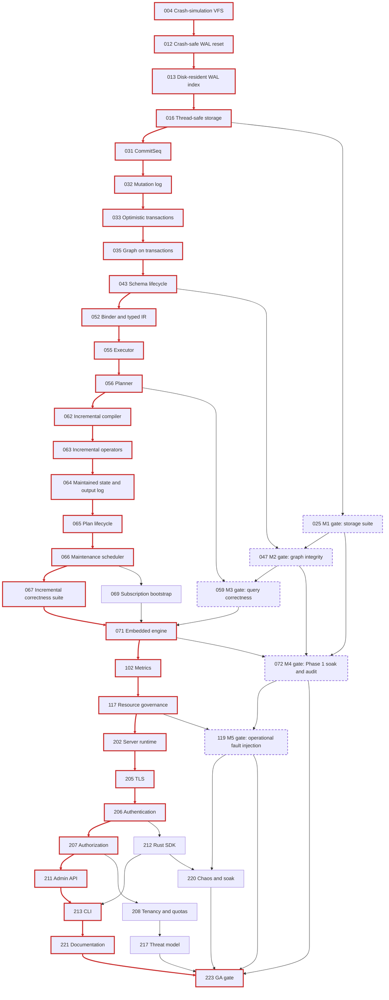
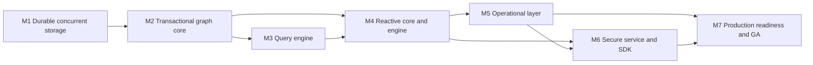

# pizzlydb: roadmap to a production-grade database

This directory is the single source of truth for taking pizzlydb from its current state to a production-grade, single-node database. It contains 112 GitHub-style issues: 100 mandatory, 3 recommended, and 9 future expansion tracks. Each issue states its motivation, the current state with code references, its scope, its dependencies, objective acceptance criteria, and how to validate it.

The assessment was made on 2026-11-06 against commit `07ad6ff` ("feat: implement records, catalogs, and indexes") together with the offline tools that commit `5c0c4ea` ("feat: implement bulk load and verify") added. It compares the code with the [implementation guide](../architecture/implementation-guide.md). Where the guide and the code disagree, the code is treated as the evidence and the guide as the target.

## Contents

1. [Project Goal](#1-project-goal)
2. [Current State Assessment](#2-current-state-assessment)
3. [Architectural Gaps](#3-architectural-gaps)
4. [Implementation Phases](#4-implementation-phases)
5. [Ordered Task List](#5-ordered-task-list)
6. [Task Dependencies](#6-task-dependencies)
7. [Dependency Graph and Critical Path](#7-dependency-graph-and-critical-path)
8. [Milestones and Exit Criteria](#8-milestones-and-exit-criteria)
9. [Production-Readiness Checklist](#9-production-readiness-checklist)

Appendices: [A. Invariant coverage](#appendix-a-invariant-coverage), [B. Guide coverage](#appendix-b-guide-coverage), [C. Mandatory and optional work](#appendix-c-mandatory-and-optional-work), [D. Assumptions](#appendix-d-assumptions), [E. Open decisions](#appendix-e-open-decisions), and [F. Conventions](#appendix-f-conventions).

## 1. Project Goal

pizzlydb is a transactional, graph-native operational database (guide [§1.1](../architecture/implementation-guide.md#11-what-pizzlydb-is)). It must:

- Store a labeled, directed, property-rich graph and mutate many nodes and edges in one serializable transaction.
- Answer snapshot graph-pattern queries deterministically, using indexes, with results that do not depend on the chosen plan.
- Maintain the results of supported bounded graph-pattern queries incrementally as the graph changes, rather than offering only a raw changefeed.
- Deliver those maintained results as durable, resumable subscriptions: a consistent snapshot, then ordered deltas, delivered at least once, with explicit errors when history has expired.

**Production-grade** means that every item in the guide's definition of done ([§15](../architecture/implementation-guide.md#15-definition-of-done-for-pizzlydb-core)) and every item in the [production-readiness checklist](#9-production-readiness-checklist) is true at the same time, each backed by evidence: passing tests, reproducible benchmarks, executed drills, and an external review ([223](223-external-review-and-ga-gate.md)).

The guide's north-star rule governs every trade-off in this roadmap: optimize for the cost, correctness, and reliability of maintaining live answers over a changing graph.

**Scope of the first production release.** One node, on Linux, with backup and restore as the recovery mechanism. Replication, sharding, and the other expansion tracks in guide [§13](../architecture/implementation-guide.md#13-implementation-roadmap-dependency-ordered) are deliberately out of scope and are tracked as RFC-gated future issues (901–909). The guide requires single-node correctness first ([§10.5](../architecture/implementation-guide.md#105-high-availability-and-distribution)).

## 2. Current State Assessment

### 2.1 Summary

The storage engine and a first graph layer exist and are well tested for single-threaded use. Everything above them does not exist yet: transactions, the logical commit log, query processing, incremental maintenance, subscriptions, the network service, security, and operations tooling. The workspace already has the crates for these layers, but they contain only doc comments.

The existing code is a sound base, but it is not yet production-quality storage:

- The engine cannot be shared between threads.
- WAL pruning can lose acknowledged commits on a crash.
- The database size is capped at about 510 MiB.
- Page lookups slow down linearly as the WAL grows.

All of these are fixable without a rewrite, and Phase 1A fixes them.

### 2.2 Baseline evidence

- **Build and lint.** `cargo test --workspace --locked` passes. `cargo clippy --workspace --all-targets --locked -- -D warnings` is clean.
- **CI.** `.github/workflows/ci.yml` runs on `ubuntu-latest` (x86-64) and covers formatting, Clippy, nextest, doctests, `cargo deny`, `cargo audit`, a CycloneDX SBOM, commitlint, REUSE, and workflow lint. The release workflow cross-builds an aarch64 archive but never tests on aarch64.
- **Toolchain.** `rust-toolchain.toml` uses `channel = "stable"`, so it is not pinned (fixed by [005](005-benchmark-harness-and-baselines.md)).
- **Safety.** The workspace sets `unsafe_code = "forbid"`.
- **Offline tools.** `backup.rs`, `verify.rs`, `inspect.rs`, and `maintain.rs` in storage, and `bulk.rs`, `salvage.rs`, and `verify.rs` in graph, implement offline backup, verification, inspection, reclaim, bulk load, and salvage. [002](002-offline-tool-identity-and-limits.md) fixes their defects.

Test inventory from `cargo test --workspace --locked`:

| Crate | Unit tests | Integration tests | Doctests |
| --- | ---: | ---: | ---: |
| `pizzlydb-core` | 13 | 9 | 68 |
| `pizzlydb-graph` | 5 | 44 | 63 |
| `pizzlydb-storage` | 149 | 38 | 46 (86 ignored) |
| All ten other crates | 0 | 0 | 0 |

The graph integration tests are `catalog_adjacency` (9), `indexes` (9), `properties` (9), `records` (8), and `salvage` (9). The storage integration tests are `backup` (6), `engine_batch` (10), `engine_checkpoint` (6), `engine_crash` (8), and `engine_snapshot` (8).

### 2.3 What exists

| Component | Status | Evidence |
| --- | --- | --- |
| VFS (POSIX, in-memory, fault wrapper) | Implemented, incomplete | `storage/src/vfs*.rs`: no locking, `set_len`, preallocation, or data-only sync. The crash model is all-or-nothing. |
| Pages and superblocks | Implemented | CRC-32C checksums, 8 KiB pages, dual superblocks, format 1.0. |
| Page-image WAL | Implemented, unsafe prune | `wal.rs`: WAL v1 (`PZLW`). Every frame is held in memory, and `prune` rewrites frames in place. |
| Pager | Implemented, single-threaded | `pager.rs`: CLOCK eviction with RAII pins, `RefCell` state, and linear-scan lookups. |
| Allocator | Implemented, capped | `space.rs`: one bitmap page (`MAX_BITMAP_PAGES`), retire spill, and horizon reclaim in `maintain.rs`. |
| B+ tree | Implemented | `btree.rs`: overflow values, parent pointers rewritten on every internal write, forward scans only, and 512-byte keys at most. |
| Storage engine | Implemented, `!Send`/`!Sync` | `engine.rs`: atomic batches, physical snapshots, and manual checkpoint. `Space` is cloned on every commit. |
| Backup, verify, inspect | Prototype | Offline only. These open the source read-write, and backup reuses the source's file identity. |
| Ids, values, key encoding | Partial | `core/src/value.rs`: 128-bit ids and six value variants. The tag order puts every integer before every float. `sequence.rs` is empty. |
| Records | Implemented | `record_store.rs`: create, update, and delete with `EndpointInUse`. Tombstones are permanent, and the id counter key is `0x01`. |
| Catalog | Implemented | `catalog.rs`: interned names, rename, and byte-exact names of at most 256 bytes. |
| Adjacency | Implemented | Both directions are written in the same batch. |
| Properties | Implemented, ad hoc rules | `property.rs`: declarations of `{value_type, nullable}` plus the "lowest-id label" rule. |
| Indexes | Implemented, single-batch build | `index.rs`: single-property indexes, with uniqueness checked inside the batch. |
| Bulk load, salvage, graph verify | Prototype | Single namespace, single batch, and a constant file identity (`id.fill(1)`). |
| Transactions | Stub | The only concurrency control is `GraphBatch::begin` holding the storage writer lock. |
| Query, incremental, subscriptions, auth, protocol, server, SDK, CLI, testkit | Stubs | Doc comments only. The CLI's `main` is empty. |

### 2.4 Defects found during the assessment

None of these had been documented before. Each is now owned by an issue.

| Defect | Consequence | Evidence | Fixed by |
| --- | --- | --- | --- |
| In-place WAL prune, synced only at the end | A crash can lose acknowledged commits (C3) | `wal.rs` `prune` | [012](012-crash-safe-wal-reset.md) |
| Bulk load and salvage use a constant file identity; backup copies the source identity | A foreign WAL file is accepted and replayed silently | `bulk.rs`, `salvage.rs`, `backup.rs` | [002](002-offline-tool-identity-and-limits.md) |
| Backup and quick verify open the source read-write, with no file lock | Recovery writes during a "read", and two processes can write | `backup.rs`, `verify.rs`, `vfs.rs` | [002](002-offline-tool-identity-and-limits.md), [011](011-vfs-capabilities.md), [015](015-exclusive-ownership-and-read-only-open.md) |
| Salvage copies one namespace | Silent data loss | `graph/src/salvage.rs` | [002](002-offline-tool-identity-and-limits.md), [109](109-repair-procedures-and-salvage-hardening.md) |
| Internal-node writes rewrite every child's parent pointer | Severe write amplification | `btree.rs` `write_internal`, `set_parent` | [023](023-btree-write-amplification.md) |
| All creates read and write the counter key `0x01` | Every concurrent create conflicts once transactions are optimistic | `graph/src/keys.rs` | [034](034-id-allocation-and-identity-policy.md) |
| Page access scans the frames and the WAL linearly | Cost grows with cache and WAL size | `pager.rs` `find_cached`, `wal_image` | [013](013-disk-resident-wal-index.md), [017](017-concurrent-page-table-and-zero-copy-reads.md) |
| Bulk load, salvage, and index build run in one batch | Memory grows with the dataset | `bulk.rs`, `salvage.rs`, `index.rs` | [019](019-bounded-write-batches.md), [044](044-online-index-build-and-drop.md), [110](110-bounded-memory-bulk-loader.md) |
| The in-memory crash model is all-or-nothing | Partial-writeback bugs, such as the prune defect, cannot be detected | `vfs_memory.rs` `crash` | [004](004-crash-consistency-simulation-vfs.md) |
| Mixed integer and float values are ordered by type tag | Range scans over mixed numerics return wrong results (C4) | `core/src/value.rs` | [040](040-type-system-and-value-model.md) |
| `PoolExhausted` is reported as an I/O error, and snapshot pin errors as corruption | Operators respond to the wrong failure | `engine.rs` `map_pager`, `SnapshotPages::pin` | [010](010-storage-error-taxonomy-fidelity.md) |
| A single allocator bitmap page | The database cannot grow beyond about 510 MiB | `space.rs` `MAX_BITMAP_PAGES` | [014](014-scalable-space-allocator.md) |
| Design gap: restore has no notion of incarnation | Clients that acknowledged positions after the backup point would skip data silently (R2) | No restore path exists | [108](108-backup-verification-and-restore.md) |

### 2.5 Guide work packages WP-01 to WP-12

Guide [§16](../architecture/implementation-guide.md#16-first-implementation-slice--concrete-work-packages) orders twelve work packages that must prove "atomic graph mutation, then durable mutation log, then consistent graph read" before any network or reactive work begins.

| WP | Requirement | Status | Completed by |
| --- | --- | --- | --- |
| WP-01 | Pinned toolchain, workspace, CI, lint | Partial: the toolchain floats and only Linux x86-64 is tested | [005](005-benchmark-harness-and-baselines.md), [216](216-packaging-and-deployment.md) |
| WP-02 | `NodeId`, `EdgeId`, `CommitSeq`, `GraphValue`, errors | Partial: `CommitSeq` is empty | [031](031-commit-sequence-and-commit-metadata.md), [040](040-type-system-and-value-model.md) |
| WP-03 | Ordered key encoding | Partial: the mixed-numeric order is wrong | [040](040-type-system-and-value-model.md) |
| WP-04 | `StorageEngine` on the page engine | Partial: single-threaded, with an unsafe prune | [012](012-crash-safe-wal-reset.md), [016](016-thread-safe-storage-engine.md) |
| WP-05 | Immutable versions and tombstones, with as-of reads per `CommitSeq` | Not started | [030](030-adr-transaction-isolation-model.md), [031](031-commit-sequence-and-commit-metadata.md), [061](061-as-of-snapshots-at-commit-sequence.md) |
| WP-06 | Forward and reverse adjacency, label indexes | Implemented. Model-based equality checks are missing | [003](003-testkit-reference-model-and-property-testing.md), [047](047-graph-integrity-suite.md) |
| WP-07 | Create, update, and delete with validation | Implemented. Detach delete and schema constraints are missing | [041](041-schema-constraints-at-commit.md), [042](042-detach-delete.md) |
| WP-08 | One mutation-log record per commit | Not started | [032](032-logical-mutation-log.md) |
| WP-09 | Transaction snapshots and commit sequencing | Partial: physical snapshots only | [031](031-commit-sequence-and-commit-metadata.md), [033](033-optimistic-transaction-manager.md) |
| WP-10 | Conflict and predicate-range validation | Not started | [033](033-optimistic-transaction-manager.md), [036](036-isolation-verification-suite.md) |
| WP-11 | Reference graph-pattern evaluator | Not started | [003](003-testkit-reference-model-and-property-testing.md), [053](053-reference-query-evaluator.md) |
| WP-12 | Log consumer and checkpoint prototype | Not started | [060](060-adr-incremental-execution-engine.md), [064](064-maintained-state-and-output-log.md) |

### 2.6 Guide milestones M0 to M8

The guide's milestones (written "guide M0" to "guide M8" here) are not the same as this roadmap's milestones M1 to M7. [Section 8](#8-milestones-and-exit-criteria) maps one to the other.

| Guide milestone | Status | Completed by |
| --- | --- | --- |
| Guide M0: repository and executable specifications | Partial. The workspace and CI exist. The semantic specifications, the reference model, and the versioning policy do not. | 001, 003, 024, 030, 040, 050 |
| Guide M1: durable graph primitives | Partial. The page engine, codecs, CRUD, and adjacency exist. The logical commit log and fault-injected restart evidence do not. | 004, 025, 032, 047 |
| Guide M2: transactional graph core | Not started (uniqueness is enforced only under the single writer) | 030–037, 041 |
| Guide M3: graph query engine | Not started | 050–059 |
| Guide M4: incremental operator kernel | Not started | 060–067 |
| Guide M5: subscription correctness | Not started | 068–071 |
| Guide M6: secure native service and SDK | Not started | 201–213 |
| Guide M7: operational hardening | Not started (offline prototypes only) | 101–119, 216, 220 |
| Guide M8: production-readiness candidate | Not started | 217–223 |

## 3. Architectural Gaps

Each gap names the missing capability, why it blocks production use, and the issues that close it.

### 3.1 Governance and verification infrastructure

- **Decisions are not recorded.** Guide §14 requires ADR-001 through ADR-010, and none exist. No CI job checks documentation links. Fixed by [001](001-design-record-and-baseline-adrs.md).
- **No oracle exists for correctness.** There is no reference graph model, no graph-level property testing, no fuzzing, and no benchmark baseline. Every later "equals the reference" acceptance criterion depends on these. Fixed by [003](003-testkit-reference-model-and-property-testing.md), [004](004-crash-consistency-simulation-vfs.md), [005](005-benchmark-harness-and-baselines.md), and [006](006-fuzzing-infrastructure.md).

### 3.2 Concurrency

- **The engine is single-threaded by construction.** `Storage` is `Rc<Inner>` with `RefCell` state. A server cannot share it across request threads, and reads cannot run in parallel. Fixed by [016](016-thread-safe-storage-engine.md) and [017](017-concurrent-page-table-and-zero-copy-reads.md).
- **Transactions hold the global writer lock for their whole lifetime.** One slow interactive client would block every writer. Fixed by [030](030-adr-transaction-isolation-model.md) and [033](033-optimistic-transaction-manager.md).

### 3.3 Durability

- **Prune is crash-unsafe, and the crash model cannot detect it.** Fixed by [004](004-crash-consistency-simulation-vfs.md) and [012](012-crash-safe-wal-reset.md).
- **Durability modes are incomplete.** There is no group commit, so every durable commit pays its own `fsync`. Only `Full` and `None` exist. Fixed by [020](020-group-commit-and-durability-modes.md).
- **Nothing bounds the WAL.** There is no automatic checkpoint. Fixed by [021](021-automatic-checkpointing-and-wal-bounds.md).
- **Ownership is unprotected.** There is no exclusive lock and no true read-only mode. Fixed by [011](011-vfs-capabilities.md) and [015](015-exclusive-ownership-and-read-only-open.md).
- **Disk-full and I/O errors are undefined.** Fixed by [022](022-disk-full-and-io-error-safety.md).

### 3.4 Storage scalability

- **The WAL is memory-resident and indexed by linear scan.** Fixed by [013](013-disk-resident-wal-index.md).
- **The database is capped at about 510 MiB.** Fixed by [014](014-scalable-space-allocator.md).
- **Batches are unbounded.** Fixed by [019](019-bounded-write-batches.md).
- **B-tree writes are amplified by parent pointers.** This is an on-disk format change, so it must land before the format freeze. Fixed by [023](023-btree-write-amplification.md).
- **Range operations are missing:** bounded and reverse scans, range delete, and size estimates. Fixed by [018](018-storage-range-operations.md).

### 3.5 Transaction semantics and the commit log

- **No commit sequence and no logical mutation log exist.** Invariant S2 (bijection between graph and log) cannot hold, and incremental maintenance has no input. Fixed by [031](031-commit-sequence-and-commit-metadata.md) and [032](032-logical-mutation-log.md).
- **No serializable validation exists, and the id counter is a guaranteed conflict hotspot.** Fixed by [033](033-optimistic-transaction-manager.md), [034](034-id-allocation-and-identity-policy.md), and [036](036-isolation-verification-suite.md).
- **No limits exist** on snapshot lifetime, transaction size, or transaction duration. Fixed by [037](037-snapshot-retention-and-transaction-limits.md).

### 3.6 Graph model

- **The value model is incomplete and its numeric ordering is wrong.** Fixed by [040](040-type-system-and-value-model.md).
- **Constraint semantics are ad hoc** (the lowest-id-label rule). Fixed by [041](041-schema-constraints-at-commit.md).
- **There is no detach delete.** Fixed by [042](042-detach-delete.md).
- **There is no schema lifecycle** (drop, retire, versions). Fixed by [043](043-schema-and-catalog-lifecycle.md).
- **Index builds are single-batch.** Fixed by [044](044-online-index-build-and-drop.md).
- **There is no namespace registry.** Fixed by [045](045-namespace-registry-and-lifecycle.md).
- **There are no statistics for planning.** Fixed by [046](046-graph-statistics.md).

### 3.7 Query processing

No language specification, parser, binder, IR, executor, planner, or reference evaluator exists. Fixed by [050](050-query-language-specification.md) through [059](059-query-correctness-suite.md).

### 3.8 Reactive core

No incremental engine, maintained state, output log, plan lifecycle, subscription cursors, bootstrap, or resume tokens exist. Fixed by [060](060-adr-incremental-execution-engine.md) through [070](070-resume-tokens.md).

### 3.9 Composition

There is no single engine API that owns startup recovery and a unified error model. Fixed by [071](071-embedded-engine-composition.md).

### 3.10 Operations

- **Backup is offline only and reuses file identity.** Fixed by [105](105-online-consistent-backup.md) and [106](106-backup-encryption-compression-destinations.md).
- **There is no restore.** Fixed by [108](108-backup-verification-and-restore.md).
- **Verification is single-namespace and uses unbounded memory.** Fixed by [107](107-full-verification-and-online-scrubbing.md).
- **There is no repair procedure.** Fixed by [109](109-repair-procedures-and-salvage-hardening.md).
- **There is no bounded-memory bulk load, export, or format upgrade.** Fixed by [110](110-bounded-memory-bulk-loader.md), [111](111-logical-export-import.md), and [112](112-format-upgrade-and-migration.md).
- **There is no compaction or retention management.** Fixed by [113](113-space-reclamation-and-compaction.md), [114](114-retention-management-and-inspection.md), and [115](115-background-maintenance-scheduler.md).
- **There is no configuration, metrics, logging, health model, diagnostics, or resource governance.** Fixed by [101](101-configuration-system.md) through [104](104-engine-lifecycle-and-health.md), [116](116-diagnostics-and-introspection.md), and [117](117-resource-governance-and-memory-budgets.md).

### 3.11 Service, security, and delivery

- **There is no protocol, server, SDK, or CLI.** Fixed by [201](201-native-protocol-definition.md) through [204](204-subscription-delivery-service.md), [212](212-rust-sdk.md), and [213](213-cli.md).
- **There is no TLS, authentication, authorization, tenancy, audit, or secrets handling.** Fixed by [205](205-tls-transport-security.md) through [210](210-secrets-management.md).
- **There is no deployment packaging, threat model, end-to-end benchmark suite, chaos testing, user documentation, or compatibility policy.** Fixed by [216](216-packaging-and-deployment.md) through [222](222-release-engineering-and-compatibility.md).

### 3.12 Where this roadmap departs from the guide

The guide was evaluated critically, not reproduced. The roadmap departs from it, or makes one of its open choices explicit, in the following places. Each departure is owned by an ADR issue, so it gets reviewed instead of silently adopted.

- **Serializable isolation is built from optimistic validation over physical snapshots.** The recommendation in [030](030-adr-transaction-isolation-model.md) is optimistic transactions over physical snapshots, with a serialized validate-and-commit step, which also yields strict serializability. Using the single writer as the commit pipeline keeps the existing storage engine design.
- **The versioning model is an explicit decision.** Guide §4.2 asks for logical record versions by `CommitSeq`. The roadmap's as-of reads ([061](061-as-of-snapshots-at-commit-sequence.md)) retain physical page versions at protected floors. [030](030-adr-transaction-isolation-model.md) must either adopt logical versioning or supersede §4.2 with evidence.
- **Group commit batches real `fsync` calls** instead of aliasing a group mode to full durability ([020](020-group-commit-and-durability-modes.md)).
- **WAL generations with salts replace in-place pruning** ([012](012-crash-safe-wal-reset.md)).
- **Id allocation leaves the transactional read set.** The current counter design would make every create conflict under any optimistic protocol ([034](034-id-allocation-and-identity-policy.md)).
- **A new `pizzlydb-engine` crate becomes the network-free composition root** ([071](071-embedded-engine-composition.md)). The guide makes the server the composition root. A separate engine crate lets every correctness suite run without a network and keeps a later embedded API possible ([905](905-embedded-c-api.md)).
- **All durable state lives in the one storage engine:** graph, mutation log, maintained state, output log, cursors, catalog, and policies. One snapshot is therefore one consistent backup ([105](105-online-consistent-backup.md)).
- **Restore bumps an incarnation epoch,** so stale resume tokens fail loudly instead of skipping changes ([108](108-backup-verification-and-restore.md)).
- **The incremental engine is chosen with prototype evidence.** Differential Dataflow is evaluated against an in-house operator library, as guide [§11.3](../architecture/implementation-guide.md#113-external-engine-evaluation) requires, and the roadmap does not presume the outcome ([060](060-adr-incremental-execution-engine.md)).

## 4. Implementation Phases

| Phase | Scope | Issues | Milestone | Gate issue |
| --- | --- | --- | --- | --- |
| 1.0 Foundations | Documentation governance, oracles, crash simulation, benchmarks, fuzzing, fixing the offline tools | 001–006 | M1 | [025](025-storage-model-based-and-crash-suite.md) |
| 1A Storage | Correctness, durability, concurrency, and scalability of the page engine | 010–025 | M1 | [025](025-storage-model-based-and-crash-suite.md) |
| 1B Transactions | Commit sequence, mutation log, serializable transactions, limits | 030–037 | M2 | [047](047-graph-integrity-suite.md) |
| 1C Graph model | Types, constraints, schema and namespace lifecycle, online indexes, statistics | 040–047 | M2 | [047](047-graph-integrity-suite.md) |
| 1D Query | Specification, parser, binder, executor, planner, paths, pagination | 050–059 | M3 | [059](059-query-correctness-suite.md) |
| 1E Reactive core | Incremental engine, maintained state, subscriptions, the embedded engine | 060–072 | M4 | [072](072-phase-1-exit-soak-and-invariant-audit.md) |
| 2 Operational layer | Configuration, observability, backup and restore, repair, load and export, upgrade, maintenance, governance | 101–119 | M5 | [119](119-operational-fault-injection-suite.md) |
| 3 Production capabilities | Protocol, server, SDK, CLI, security, tenancy, deployment, testing at scale, docs, release, external review | 201–223 | M6, M7 | [223](223-external-review-and-ga-gate.md) |
| Future | RFC-gated expansion after GA | 901–909 | none | none |

Phase 1 takes priority over Phase 2, and Phase 2 over Phase 3. Issue numbers form a valid topological order, because every dependency points to a lower-numbered issue. Within that order:

- **Pull work in phase order.** A later-phase issue may start early only when every dependency is closed and doing so does not take capacity from the critical path. Examples: 003, 004, and 006 can start immediately. 040 and 050 can start as soon as 001 lands. 201 can start right after 071.
- **Gates are hard.** A milestone's work may begin before the previous gate closes, but no milestone gate closes before the previous one. In particular, [119](119-operational-fault-injection-suite.md) depends on [072](072-phase-1-exit-soak-and-invariant-audit.md), and [223](223-external-review-and-ga-gate.md) depends on both.
- **The format freeze comes before Phase 2.** Changes to the on-disk format ([012](012-crash-safe-wal-reset.md), [013](013-disk-resident-wal-index.md), [014](014-scalable-space-allocator.md), and [023](023-btree-write-amplification.md)) land before the policy and golden fixtures in [024](024-storage-format-versioning-and-golden-fixtures.md). Every later change goes through the upgrade framework ([112](112-format-upgrade-and-migration.md)).

### Cross-phase prerequisites

These are dependencies that cross a phase boundary. Each is also listed in the issue's Dependencies section.

- **Phase 1.0 into everything:**
  - [001](001-design-record-and-baseline-adrs.md) gates every decision document (030, 040, 050).
  - [003](003-testkit-reference-model-and-property-testing.md) gates every oracle-based suite (005, 025, 036, 053).
  - [004](004-crash-consistency-simulation-vfs.md) gates the durability work (011, 012, 014) and the incremental crash tests (067).
  - [006](006-fuzzing-infrastructure.md) gates the parser (051) and security hardening (217).
- **Phase 1A into Phases 1B to 1E:**
  - [016](016-thread-safe-storage-engine.md) gates 031, 033, 034, and 066.
  - [018](018-storage-range-operations.md) gates 032, 033, 045, and 054.
  - [019](019-bounded-write-batches.md) and [020](020-group-commit-and-durability-modes.md) gate 033.
  - [021](021-automatic-checkpointing-and-wal-bounds.md) gates 037 and 061.
  - [013](013-disk-resident-wal-index.md) gates 061.
- **Phase 1 into Phase 2:**
  - [071](071-embedded-engine-composition.md) gates 101–104 and 108.
  - [015](015-exclusive-ownership-and-read-only-open.md), [016](016-thread-safe-storage-engine.md), [024](024-storage-format-versioning-and-golden-fixtures.md), and [031](031-commit-sequence-and-commit-metadata.md) gate 105.
  - [045](045-namespace-registry-and-lifecycle.md), [032](032-logical-mutation-log.md), and [064](064-maintained-state-and-output-log.md) gate 107.
  - [055](055-physical-operators-and-executor.md), [066](066-maintenance-scheduler-and-lag.md), and [069](069-subscription-bootstrap-and-event-stream.md) gate 117.
  - [072](072-phase-1-exit-soak-and-invariant-audit.md) gates 119.
- **Phase 1 directly into Phase 3:**
  - [070](070-resume-tokens.md) and [071](071-embedded-engine-composition.md) gate 201.
  - [033](033-optimistic-transaction-manager.md) and [058](058-ordering-and-pagination.md) gate 203.
  - [069](069-subscription-bootstrap-and-event-stream.md) gates 204.
  - [045](045-namespace-registry-and-lifecycle.md) gates 207 and 208.
  - [005](005-benchmark-harness-and-baselines.md) and [072](072-phase-1-exit-soak-and-invariant-audit.md) gate 219.
  - [050](050-query-language-specification.md) gates 221.
- **Phase 2 into Phase 3:**
  - [102](102-metrics-foundation.md), [103](103-structured-logging-and-tracing.md), [104](104-engine-lifecycle-and-health.md), and [117](117-resource-governance-and-memory-budgets.md) gate 202.
  - [108](108-backup-verification-and-restore.md), [114](114-retention-management-and-inspection.md), and [116](116-diagnostics-and-introspection.md) gate 211.
  - [101](101-configuration-system.md) and [106](106-backup-encryption-compression-destinations.md) gate 210.
  - [110](110-bounded-memory-bulk-loader.md), [111](111-logical-export-import.md), and [112](112-format-upgrade-and-migration.md) gate 213.
  - [114](114-retention-management-and-inspection.md) and [117](117-resource-governance-and-memory-budgets.md) gate 208.
  - [112](112-format-upgrade-and-migration.md) gates 222.
  - [119](119-operational-fault-injection-suite.md) gates 220 and 223.

## 5. Ordered Task List

Within each phase, tasks are listed in dependency order. "Critical path" marks issues on the weighted critical path ([section 7](#7-dependency-graph-and-critical-path)), "near-critical path" marks issues on the next-longest chains, "gate" marks milestone exit gates, and "decision" marks ADR issues that block design work. Sizes are defined in [Appendix F](#appendix-f-conventions).

### Phase 1.0: Foundations

| # | Issue | Priority | Size |
| --- | --- | --- | --- |
| 001 | [Establish the design record and the baseline ADRs](001-design-record-and-baseline-adrs.md) | Must | M |
| 002 | [Fix file identity and document the limits of backup, verify, salvage, and bulk load](002-offline-tool-identity-and-limits.md) | Must | M |
| 003 | [Testkit reference graph model, workload generator, and property-testing harness](003-testkit-reference-model-and-property-testing.md) | Must | L |
| 004 | [Crash-consistency simulation VFS with partial writeback, reordering, and fsync failure](004-crash-consistency-simulation-vfs.md) | Must, critical path | M |
| 005 | [Benchmark harness and first Rust baseline measurements](005-benchmark-harness-and-baselines.md) | Must | M |
| 006 | [Fuzzing infrastructure for every on-disk and wire decoder](006-fuzzing-infrastructure.md) | Must | M |

### Phase 1A: Storage engine hardening

| # | Issue | Priority | Size |
| --- | --- | --- | --- |
| 010 | [Storage error taxonomy fidelity: stop reporting I/O failures as corruption](010-storage-error-taxonomy-fidelity.md) | Must | S |
| 011 | [VFS capabilities: advisory locking, truncation, preallocation, and data-only sync](011-vfs-capabilities.md) | Must | M |
| 012 | [Crash-safe WAL reset: remove the in-place prune and add salted WAL generations](012-crash-safe-wal-reset.md) | Must, critical path | M |
| 013 | [Disk-resident WAL with a bounded in-memory version index](013-disk-resident-wal-index.md) | Must, critical path | L |
| 014 | [Scalable free-space allocator: remove the ~510 MiB database size limit](014-scalable-space-allocator.md) | Must | L |
| 015 | [Exclusive database ownership and a true read-only open mode](015-exclusive-ownership-and-read-only-open.md) | Must | M |
| 016 | [Thread-safe storage engine: `Send + Sync`, concurrent readers, one writer](016-thread-safe-storage-engine.md) | Must, critical path | XL |
| 017 | [Concurrent page table and zero-copy read path](017-concurrent-page-table-and-zero-copy-reads.md) | Must | L |
| 018 | [Storage range operations: bounded and reverse scans, range delete, size estimates](018-storage-range-operations.md) | Must | M |
| 019 | [Bounded write batches and transaction size limits](019-bounded-write-batches.md) | Must | M |
| 020 | [Group commit and well-defined durability modes](020-group-commit-and-durability-modes.md) | Must | L |
| 021 | [Automatic checkpointing and WAL growth control](021-automatic-checkpointing-and-wal-bounds.md) | Must | M |
| 022 | [Disk-full and I/O-error safety](022-disk-full-and-io-error-safety.md) | Must | M |
| 023 | [Reduce B+ tree write amplification by removing stored parent pointers](023-btree-write-amplification.md) | Must | L |
| 024 | [Storage format versioning policy and golden compatibility fixtures](024-storage-format-versioning-and-golden-fixtures.md) | Must | M |
| 025 | [Storage model-based and crash-consistency suite (exit gate for Phase 1A)](025-storage-model-based-and-crash-suite.md) | Must, gate | L |

### Phase 1B: Transactions and logical commit log

| # | Issue | Priority | Size |
| --- | --- | --- | --- |
| 030 | [ADR-004: transaction, isolation, and commit-sequence model](030-adr-transaction-isolation-model.md) | Must, decision | M |
| 031 | [`CommitSeq` and durable commit metadata](031-commit-sequence-and-commit-metadata.md) | Must, critical path | M |
| 032 | [Logical mutation log, atomic with each commit](032-logical-mutation-log.md) | Must, critical path | L |
| 033 | [Optimistic transaction manager with serializable validation](033-optimistic-transaction-manager.md) | Must, critical path | XL |
| 034 | [Conflict-free id allocation and the identity and tombstone policy (ADR-002, part 1)](034-id-allocation-and-identity-policy.md) | Must | M |
| 035 | [Port the graph layer onto the transaction manager and emit mutation records](035-graph-on-transactions.md) | Must, critical path | L |
| 036 | [Isolation verification suite with a history checker](036-isolation-verification-suite.md) | Must | L |
| 037 | [Snapshot retention, long-reader limits, snapshot leases, and transaction expiry](037-snapshot-retention-and-transaction-limits.md) | Must | M |

### Phase 1C: Graph model completion

| # | Issue | Priority | Size |
| --- | --- | --- | --- |
| 040 | [Type-system RFC and value model completion (ADR-002, part 2)](040-type-system-and-value-model.md) | Must, decision | XL |
| 041 | [Schema constraints at commit: required properties, type checks, and declaration semantics](041-schema-constraints-at-commit.md) | Must | L |
| 042 | [Detach delete with bounded cascades](042-detach-delete.md) | Must | M |
| 043 | [Schema and catalog lifecycle: drop, retire, schema versions, and change events](043-schema-and-catalog-lifecycle.md) | Must, critical path | L |
| 044 | [Online, multi-transaction index build](044-online-index-build-and-drop.md) | Must | L |
| 045 | [Namespace registry and lifecycle](045-namespace-registry-and-lifecycle.md) | Must | M |
| 046 | [Graph statistics for planning and quotas](046-graph-statistics.md) | Must | M |
| 047 | [Graph integrity and model-based suite (exit gate for Phases 1B and 1C)](047-graph-integrity-suite.md) | Must, gate | L |

### Phase 1D: Query engine

| # | Issue | Priority | Size |
| --- | --- | --- | --- |
| 050 | [Query-language specification RFC (ADR-006)](050-query-language-specification.md) | Must, decision | L |
| 051 | [Query parser and AST](051-query-parser-and-ast.md) | Must | M |
| 052 | [Binder, type checker, authorization hook, and the versioned typed IR](052-binder-type-checker-and-ir.md) | Must, critical path | L |
| 053 | [Reference query evaluator, used as the oracle](053-reference-query-evaluator.md) | Must | M |
| 054 | [Graph read interfaces for query execution](054-graph-read-interfaces-for-execution.md) | Must | M |
| 055 | [Physical operators and the pull-based executor](055-physical-operators-and-executor.md) | Must, critical path | XL |
| 056 | [Planner, cost model, resource safeguards, EXPLAIN, and the plan cache](056-planner-cost-model-and-explain.md) | Must, critical path | XL |
| 057 | [Bounded variable-length paths and explicit path semantics](057-bounded-variable-length-paths.md) | Must | L |
| 058 | [Snapshot-consistent ordering and pagination](058-ordering-and-pagination.md) | Must | M |
| 059 | [Query correctness suite (exit gate for Phase 1D)](059-query-correctness-suite.md) | Must, gate | M |

### Phase 1E: Reactive core

| # | Issue | Priority | Size |
| --- | --- | --- | --- |
| 060 | [ADR-007: choosing the incremental execution engine, with prototype evidence](060-adr-incremental-execution-engine.md) | Must, decision | L |
| 061 | [As-of snapshots at a retained `CommitSeq`](061-as-of-snapshots-at-commit-sequence.md) | Must | L |
| 062 | [Reactive admissibility checker and incremental plan compiler](062-incremental-admissibility-and-compiler.md) | Must, critical path | L |
| 063 | [Incremental operator library: signed deltas, joins, distinct, and aggregates](063-incremental-operators.md) | Must, critical path | XL |
| 064 | [Maintained-state persistence, the output-delta log, and atomic progress](064-maintained-state-and-output-log.md) | Must, critical path | L |
| 065 | [Plan installation, sharing, invalidation, and restart recovery](065-plan-installation-and-lifecycle.md) | Must, critical path | L |
| 066 | [Maintenance scheduler, lag tracking, `wait_until_maintained`, and backpressure](066-maintenance-scheduler-and-lag.md) | Must, critical path | L |
| 067 | [Incremental correctness suite (C5–C7 at engine level)](067-incremental-correctness-suite.md) | Must, gate, critical path | L |
| 068 | [Durable subscriptions core: identity, cursors, leases, retention, and expiry (ADR-008)](068-durable-subscriptions-core.md) | Must, decision | L |
| 069 | [Race-free subscription bootstrap and the in-process event stream](069-subscription-bootstrap-and-event-stream.md) | Must, near-critical path | L |
| 070 | [Resume tokens](070-resume-tokens.md) | Must | M |
| 071 | [Embedded engine composition, startup recovery, the unified error model, and the end-to-end scenario](071-embedded-engine-composition.md) | Must, critical path | L |
| 072 | [Phase 1 exit gate: engine soak test and invariant audit](072-phase-1-exit-soak-and-invariant-audit.md) | Must, gate | M |

### Phase 2: Operational layer

| # | Issue | Priority | Size |
| --- | --- | --- | --- |
| 101 | [Configuration system and data-directory layout](101-configuration-system.md) | Must | M |
| 102 | [Metrics foundation, reference dashboards, and alert rules](102-metrics-foundation.md) | Must, critical path | L |
| 103 | [Structured logging and OpenTelemetry-compatible tracing](103-structured-logging-and-tracing.md) | Must | M |
| 104 | [Engine lifecycle, graceful shutdown, poison recovery, and the health model](104-engine-lifecycle-and-health.md) | Must | M |
| 105 | [Online consistent backup with a manifest](105-online-consistent-backup.md) | Must | L |
| 106 | [Backup encryption, compression, and destinations](106-backup-encryption-compression-destinations.md) | Must (encryption, local), Should (object storage) | M |
| 107 | [Multi-namespace full verification and online scrubbing](107-full-verification-and-online-scrubbing.md) | Must | L |
| 108 | [Backup verification, restore, incarnation epochs, and restore drills](108-backup-verification-and-restore.md) | Must | L |
| 109 | [Repair procedures and salvage hardening](109-repair-procedures-and-salvage-hardening.md) | Must | L |
| 110 | [Bounded-memory bulk loader with a bottom-up B-tree builder](110-bounded-memory-bulk-loader.md) | Must | L |
| 111 | [Logical export and import (portable dump)](111-logical-export-import.md) | Must | M |
| 112 | [Format upgrade and migration framework, with downgrade gates](112-format-upgrade-and-migration.md) | Must | L |
| 113 | [Space reclamation, B-tree compaction, file shrinking, and tombstone GC](113-space-reclamation-and-compaction.md) | Must | L |
| 114 | [Retention management and `inspect_retention` (ADR-010)](114-retention-management-and-inspection.md) | Must, decision | M |
| 115 | [Unified background maintenance scheduler](115-background-maintenance-scheduler.md) | Must | M |
| 116 | [Diagnostics and introspection, `EXPLAIN ANALYZE`, and diagnostic bundles](116-diagnostics-and-introspection.md) | Must | M |
| 117 | [Resource governance: memory budgets, admission control, and limits](117-resource-governance-and-memory-budgets.md) | Must, critical path | L |
| 118 | [Continuous log archiving and point-in-time restore](118-log-archiving-and-point-in-time-restore.md) | Should | L |
| 119 | [Operational fault-injection and recovery suite (exit gate for Phase 2)](119-operational-fault-injection-suite.md) | Must, gate | L |

### Phase 3: Production capabilities

| # | Issue | Priority | Size |
| --- | --- | --- | --- |
| 201 | [Native protocol definition (Protobuf and gRPC) with a compatibility policy](201-native-protocol-definition.md) | Must | L |
| 202 | [Server runtime: async front end, blocking execution pools, request lifecycle, and health endpoints](202-server-runtime.md) | Must, critical path | L |
| 203 | [Transaction and query service: interactive sessions, idempotency, and streaming results](203-transaction-and-query-service.md) | Must | L |
| 204 | [Subscription delivery service: streaming, acknowledgements, flow control, and resume](204-subscription-delivery-service.md) | Must | L |
| 205 | [TLS and mTLS transport security](205-tls-transport-security.md) | Must, critical path | M |
| 206 | [Authentication: OIDC/JWT, service principals, and API credentials](206-authentication.md) | Must, critical path | L |
| 207 | [Authorization: RBAC, enforcement points, and policy epochs (ADR-009)](207-authorization-rbac-and-policy-epochs.md) | Must, decision, critical path | L |
| 208 | [Multi-tenancy and quotas](208-multi-tenancy-and-quotas.md) | Must | L |
| 209 | [Tamper-evident audit logging](209-audit-logging.md) | Must | M |
| 210 | [Secrets management and key rotation](210-secrets-management.md) | Must | M |
| 211 | [Administrative API](211-admin-api.md) | Must, critical path | M |
| 212 | [Rust SDK](212-rust-sdk.md) | Must, near-critical path | L |
| 213 | [CLI: `serve`, admin commands, offline tools, and query shell](213-cli.md) | Must, critical path | L |
| 214 | [Query-language data modification (INSERT, SET, REMOVE, DELETE, DETACH DELETE)](214-gql-data-modification.md) | Should | L |
| 215 | [CSV and JSON Lines import and export](215-csv-jsonl-import-export.md) | Should | M |
| 216 | [Packaging and deployment: container image, systemd unit, Kubernetes manifests, and runbooks](216-packaging-and-deployment.md) | Must | M |
| 217 | [Threat model, security hardening, and supply-chain controls](217-security-hardening-and-threat-model.md) | Must | M |
| 218 | [Security test suite: authorization matrix, tenant isolation, and revocation during delivery](218-security-test-suite.md) | Must | M |
| 219 | [Benchmark suite, published results, and service-level objectives](219-benchmark-suite-and-slos.md) | Must | L |
| 220 | [Chaos, soak, and long-running simulation testing](220-chaos-soak-and-simulation-testing.md) | Must | L |
| 221 | [Documentation set: user, operator, reference, and contributor docs](221-documentation-set.md) | Must, critical path | L |
| 222 | [Release engineering, versioning, and compatibility guarantees](222-release-engineering-and-compatibility.md) | Must | M |
| 223 | [External review and general-availability gate](223-external-review-and-ga-gate.md) | Must, gate, critical path | M |

### Future: post-GA expansion tracks

Each of these requires an accepted, evidence-backed RFC before implementation, as guide [§13](../architecture/implementation-guide.md#13-implementation-roadmap-dependency-ordered) requires.

| # | Issue | Priority | Size |
| --- | --- | --- | --- |
| 901 | [Replication and high availability (RFC-gated)](901-replication-and-high-availability.md) | Could | XL |
| 902 | [Additional SDKs (TypeScript, Python, Go, Java)](902-additional-sdks.md) | Could | L per language |
| 903 | [Incremental maintenance of bounded variable-length paths (RFC-gated)](903-incremental-variable-length-paths.md) | Could | XL |
| 904 | [Composite, full-text, vector, and spatial indexes (RFC-gated)](904-composite-and-specialized-indexes.md) | Could | XL |
| 905 | [Stable embedded API and C ABI](905-embedded-c-api.md) | Could | L |
| 906 | [User-facing time-travel queries (RFC-gated)](906-time-travel-queries.md) | Could | L |
| 907 | [Sharding and distributed execution (RFC-gated)](907-sharding-and-distributed-execution.md) | Won't (v1) | XXL |
| 908 | [Fine-grained authorization: label-, property-, and row-level policies (RFC-gated)](908-fine-grained-authorization.md) | Could | XL |
| 909 | [Native encryption at rest for the live database (RFC-gated)](909-native-encryption-at-rest.md) | Could | L |

## 6. Task Dependencies

"Depends on" lists the issues that must be closed before an issue can be closed. "Required by" is the reverse relation. Every dependency points to a lower-numbered issue, so the graph has no cycles. An issue's Dependencies section may mention other issues for context after the word "None". Those mentions are not dependencies.

| Issue | Depends on | Required by |
| --- | --- | --- |
| [001](001-design-record-and-baseline-adrs.md) | None | [030](030-adr-transaction-isolation-model.md), [040](040-type-system-and-value-model.md), [050](050-query-language-specification.md) |
| [002](002-offline-tool-identity-and-limits.md) | None | [035](035-graph-on-transactions.md) |
| [003](003-testkit-reference-model-and-property-testing.md) | None | [005](005-benchmark-harness-and-baselines.md), [025](025-storage-model-based-and-crash-suite.md), [036](036-isolation-verification-suite.md), [053](053-reference-query-evaluator.md) |
| [004](004-crash-consistency-simulation-vfs.md) | None | [011](011-vfs-capabilities.md), [012](012-crash-safe-wal-reset.md), [014](014-scalable-space-allocator.md), [025](025-storage-model-based-and-crash-suite.md), [067](067-incremental-correctness-suite.md) |
| [005](005-benchmark-harness-and-baselines.md) | [003](003-testkit-reference-model-and-property-testing.md) | [017](017-concurrent-page-table-and-zero-copy-reads.md), [023](023-btree-write-amplification.md), [219](219-benchmark-suite-and-slos.md) |
| [006](006-fuzzing-infrastructure.md) | None | [051](051-query-parser-and-ast.md), [217](217-security-hardening-and-threat-model.md) |
| [010](010-storage-error-taxonomy-fidelity.md) | None | [012](012-crash-safe-wal-reset.md), [014](014-scalable-space-allocator.md), [016](016-thread-safe-storage-engine.md), [018](018-storage-range-operations.md), [019](019-bounded-write-batches.md), [023](023-btree-write-amplification.md) |
| [011](011-vfs-capabilities.md) | [004](004-crash-consistency-simulation-vfs.md) | [015](015-exclusive-ownership-and-read-only-open.md), [020](020-group-commit-and-durability-modes.md), [022](022-disk-full-and-io-error-safety.md), [113](113-space-reclamation-and-compaction.md), [909](909-native-encryption-at-rest.md) |
| [012](012-crash-safe-wal-reset.md) | [004](004-crash-consistency-simulation-vfs.md), [010](010-storage-error-taxonomy-fidelity.md) | [013](013-disk-resident-wal-index.md), [021](021-automatic-checkpointing-and-wal-bounds.md), [024](024-storage-format-versioning-and-golden-fixtures.md), [025](025-storage-model-based-and-crash-suite.md) |
| [013](013-disk-resident-wal-index.md) | [012](012-crash-safe-wal-reset.md) | [016](016-thread-safe-storage-engine.md), [019](019-bounded-write-batches.md), [020](020-group-commit-and-durability-modes.md), [021](021-automatic-checkpointing-and-wal-bounds.md), [022](022-disk-full-and-io-error-safety.md), [024](024-storage-format-versioning-and-golden-fixtures.md), [025](025-storage-model-based-and-crash-suite.md), [061](061-as-of-snapshots-at-commit-sequence.md) |
| [014](014-scalable-space-allocator.md) | [004](004-crash-consistency-simulation-vfs.md), [010](010-storage-error-taxonomy-fidelity.md) | [024](024-storage-format-versioning-and-golden-fixtures.md), [025](025-storage-model-based-and-crash-suite.md), [113](113-space-reclamation-and-compaction.md) |
| [015](015-exclusive-ownership-and-read-only-open.md) | [011](011-vfs-capabilities.md) | [025](025-storage-model-based-and-crash-suite.md), [105](105-online-consistent-backup.md) |
| [016](016-thread-safe-storage-engine.md) | [010](010-storage-error-taxonomy-fidelity.md), [013](013-disk-resident-wal-index.md) | [017](017-concurrent-page-table-and-zero-copy-reads.md), [020](020-group-commit-and-durability-modes.md), [021](021-automatic-checkpointing-and-wal-bounds.md), [025](025-storage-model-based-and-crash-suite.md), [031](031-commit-sequence-and-commit-metadata.md), [033](033-optimistic-transaction-manager.md), [034](034-id-allocation-and-identity-policy.md), [066](066-maintenance-scheduler-and-lag.md), [102](102-metrics-foundation.md), [103](103-structured-logging-and-tracing.md), [105](105-online-consistent-backup.md), [107](107-full-verification-and-online-scrubbing.md) |
| [017](017-concurrent-page-table-and-zero-copy-reads.md) | [005](005-benchmark-harness-and-baselines.md), [016](016-thread-safe-storage-engine.md) | [025](025-storage-model-based-and-crash-suite.md) |
| [018](018-storage-range-operations.md) | [010](010-storage-error-taxonomy-fidelity.md) | [025](025-storage-model-based-and-crash-suite.md), [032](032-logical-mutation-log.md), [033](033-optimistic-transaction-manager.md), [045](045-namespace-registry-and-lifecycle.md), [054](054-graph-read-interfaces-for-execution.md) |
| [019](019-bounded-write-batches.md) | [010](010-storage-error-taxonomy-fidelity.md), [013](013-disk-resident-wal-index.md) | [025](025-storage-model-based-and-crash-suite.md), [033](033-optimistic-transaction-manager.md), [044](044-online-index-build-and-drop.md), [117](117-resource-governance-and-memory-budgets.md) |
| [020](020-group-commit-and-durability-modes.md) | [011](011-vfs-capabilities.md), [013](013-disk-resident-wal-index.md), [016](016-thread-safe-storage-engine.md) | [025](025-storage-model-based-and-crash-suite.md), [033](033-optimistic-transaction-manager.md) |
| [021](021-automatic-checkpointing-and-wal-bounds.md) | [012](012-crash-safe-wal-reset.md), [013](013-disk-resident-wal-index.md), [016](016-thread-safe-storage-engine.md) | [022](022-disk-full-and-io-error-safety.md), [025](025-storage-model-based-and-crash-suite.md), [037](037-snapshot-retention-and-transaction-limits.md), [061](061-as-of-snapshots-at-commit-sequence.md), [104](104-engine-lifecycle-and-health.md), [113](113-space-reclamation-and-compaction.md), [115](115-background-maintenance-scheduler.md) |
| [022](022-disk-full-and-io-error-safety.md) | [011](011-vfs-capabilities.md), [013](013-disk-resident-wal-index.md), [021](021-automatic-checkpointing-and-wal-bounds.md) | [025](025-storage-model-based-and-crash-suite.md), [104](104-engine-lifecycle-and-health.md) |
| [023](023-btree-write-amplification.md) | [005](005-benchmark-harness-and-baselines.md), [010](010-storage-error-taxonomy-fidelity.md) | [024](024-storage-format-versioning-and-golden-fixtures.md), [025](025-storage-model-based-and-crash-suite.md) |
| [024](024-storage-format-versioning-and-golden-fixtures.md) | [012](012-crash-safe-wal-reset.md), [013](013-disk-resident-wal-index.md), [014](014-scalable-space-allocator.md), [023](023-btree-write-amplification.md) | [025](025-storage-model-based-and-crash-suite.md), [105](105-online-consistent-backup.md), [110](110-bounded-memory-bulk-loader.md), [112](112-format-upgrade-and-migration.md), [909](909-native-encryption-at-rest.md) |
| [025](025-storage-model-based-and-crash-suite.md) | [003](003-testkit-reference-model-and-property-testing.md), [004](004-crash-consistency-simulation-vfs.md), [012](012-crash-safe-wal-reset.md), [013](013-disk-resident-wal-index.md), [014](014-scalable-space-allocator.md), [015](015-exclusive-ownership-and-read-only-open.md), [016](016-thread-safe-storage-engine.md), [017](017-concurrent-page-table-and-zero-copy-reads.md), [018](018-storage-range-operations.md), [019](019-bounded-write-batches.md), [020](020-group-commit-and-durability-modes.md), [021](021-automatic-checkpointing-and-wal-bounds.md), [022](022-disk-full-and-io-error-safety.md), [023](023-btree-write-amplification.md), [024](024-storage-format-versioning-and-golden-fixtures.md) | [047](047-graph-integrity-suite.md), [072](072-phase-1-exit-soak-and-invariant-audit.md) |
| [030](030-adr-transaction-isolation-model.md) | [001](001-design-record-and-baseline-adrs.md) | [031](031-commit-sequence-and-commit-metadata.md), [033](033-optimistic-transaction-manager.md), [034](034-id-allocation-and-identity-policy.md) |
| [031](031-commit-sequence-and-commit-metadata.md) | [016](016-thread-safe-storage-engine.md), [030](030-adr-transaction-isolation-model.md) | [032](032-logical-mutation-log.md), [033](033-optimistic-transaction-manager.md), [061](061-as-of-snapshots-at-commit-sequence.md), [105](105-online-consistent-backup.md) |
| [032](032-logical-mutation-log.md) | [018](018-storage-range-operations.md), [031](031-commit-sequence-and-commit-metadata.md) | [033](033-optimistic-transaction-manager.md), [035](035-graph-on-transactions.md), [043](043-schema-and-catalog-lifecycle.md), [060](060-adr-incremental-execution-engine.md), [061](061-as-of-snapshots-at-commit-sequence.md), [064](064-maintained-state-and-output-log.md), [107](107-full-verification-and-online-scrubbing.md), [110](110-bounded-memory-bulk-loader.md), [114](114-retention-management-and-inspection.md), [118](118-log-archiving-and-point-in-time-restore.md) |
| [033](033-optimistic-transaction-manager.md) | [016](016-thread-safe-storage-engine.md), [018](018-storage-range-operations.md), [019](019-bounded-write-batches.md), [020](020-group-commit-and-durability-modes.md), [030](030-adr-transaction-isolation-model.md), [031](031-commit-sequence-and-commit-metadata.md), [032](032-logical-mutation-log.md) | [035](035-graph-on-transactions.md), [037](037-snapshot-retention-and-transaction-limits.md), [044](044-online-index-build-and-drop.md), [046](046-graph-statistics.md), [203](203-transaction-and-query-service.md) |
| [034](034-id-allocation-and-identity-policy.md) | [016](016-thread-safe-storage-engine.md), [030](030-adr-transaction-isolation-model.md) | [035](035-graph-on-transactions.md), [113](113-space-reclamation-and-compaction.md) |
| [035](035-graph-on-transactions.md) | [002](002-offline-tool-identity-and-limits.md), [032](032-logical-mutation-log.md), [033](033-optimistic-transaction-manager.md), [034](034-id-allocation-and-identity-policy.md) | [036](036-isolation-verification-suite.md), [041](041-schema-constraints-at-commit.md), [042](042-detach-delete.md), [043](043-schema-and-catalog-lifecycle.md), [045](045-namespace-registry-and-lifecycle.md), [046](046-graph-statistics.md), [054](054-graph-read-interfaces-for-execution.md) |
| [036](036-isolation-verification-suite.md) | [003](003-testkit-reference-model-and-property-testing.md), [035](035-graph-on-transactions.md) | [047](047-graph-integrity-suite.md) |
| [037](037-snapshot-retention-and-transaction-limits.md) | [021](021-automatic-checkpointing-and-wal-bounds.md), [033](033-optimistic-transaction-manager.md) | [058](058-ordering-and-pagination.md), [061](061-as-of-snapshots-at-commit-sequence.md), [071](071-embedded-engine-composition.md), [114](114-retention-management-and-inspection.md) |
| [040](040-type-system-and-value-model.md) | [001](001-design-record-and-baseline-adrs.md) | [041](041-schema-constraints-at-commit.md), [050](050-query-language-specification.md), [052](052-binder-type-checker-and-ir.md), [110](110-bounded-memory-bulk-loader.md), [111](111-logical-export-import.md) |
| [041](041-schema-constraints-at-commit.md) | [035](035-graph-on-transactions.md), [040](040-type-system-and-value-model.md) | [047](047-graph-integrity-suite.md) |
| [042](042-detach-delete.md) | [035](035-graph-on-transactions.md) | [047](047-graph-integrity-suite.md), [214](214-gql-data-modification.md) |
| [043](043-schema-and-catalog-lifecycle.md) | [032](032-logical-mutation-log.md), [035](035-graph-on-transactions.md) | [044](044-online-index-build-and-drop.md), [047](047-graph-integrity-suite.md), [052](052-binder-type-checker-and-ir.md), [065](065-plan-installation-and-lifecycle.md), [111](111-logical-export-import.md) |
| [044](044-online-index-build-and-drop.md) | [019](019-bounded-write-batches.md), [033](033-optimistic-transaction-manager.md), [043](043-schema-and-catalog-lifecycle.md) | [047](047-graph-integrity-suite.md), [109](109-repair-procedures-and-salvage-hardening.md), [904](904-composite-and-specialized-indexes.md) |
| [045](045-namespace-registry-and-lifecycle.md) | [018](018-storage-range-operations.md), [035](035-graph-on-transactions.md) | [047](047-graph-integrity-suite.md), [071](071-embedded-engine-composition.md), [107](107-full-verification-and-online-scrubbing.md), [110](110-bounded-memory-bulk-loader.md), [207](207-authorization-rbac-and-policy-epochs.md), [208](208-multi-tenancy-and-quotas.md) |
| [046](046-graph-statistics.md) | [033](033-optimistic-transaction-manager.md), [035](035-graph-on-transactions.md) | [047](047-graph-integrity-suite.md), [054](054-graph-read-interfaces-for-execution.md), [056](056-planner-cost-model-and-explain.md) |
| [047](047-graph-integrity-suite.md) | [025](025-storage-model-based-and-crash-suite.md), [036](036-isolation-verification-suite.md), [041](041-schema-constraints-at-commit.md), [042](042-detach-delete.md), [043](043-schema-and-catalog-lifecycle.md), [044](044-online-index-build-and-drop.md), [045](045-namespace-registry-and-lifecycle.md), [046](046-graph-statistics.md) | [059](059-query-correctness-suite.md), [072](072-phase-1-exit-soak-and-invariant-audit.md) |
| [050](050-query-language-specification.md) | [001](001-design-record-and-baseline-adrs.md), [040](040-type-system-and-value-model.md) | [051](051-query-parser-and-ast.md), [221](221-documentation-set.md) |
| [051](051-query-parser-and-ast.md) | [006](006-fuzzing-infrastructure.md), [050](050-query-language-specification.md) | [052](052-binder-type-checker-and-ir.md) |
| [052](052-binder-type-checker-and-ir.md) | [040](040-type-system-and-value-model.md), [043](043-schema-and-catalog-lifecycle.md), [051](051-query-parser-and-ast.md) | [053](053-reference-query-evaluator.md), [055](055-physical-operators-and-executor.md), [060](060-adr-incremental-execution-engine.md) |
| [053](053-reference-query-evaluator.md) | [003](003-testkit-reference-model-and-property-testing.md), [052](052-binder-type-checker-and-ir.md) | [059](059-query-correctness-suite.md), [060](060-adr-incremental-execution-engine.md), [067](067-incremental-correctness-suite.md) |
| [054](054-graph-read-interfaces-for-execution.md) | [018](018-storage-range-operations.md), [035](035-graph-on-transactions.md), [046](046-graph-statistics.md) | [055](055-physical-operators-and-executor.md) |
| [055](055-physical-operators-and-executor.md) | [052](052-binder-type-checker-and-ir.md), [054](054-graph-read-interfaces-for-execution.md) | [056](056-planner-cost-model-and-explain.md), [058](058-ordering-and-pagination.md), [117](117-resource-governance-and-memory-budgets.md) |
| [056](056-planner-cost-model-and-explain.md) | [046](046-graph-statistics.md), [055](055-physical-operators-and-executor.md) | [057](057-bounded-variable-length-paths.md), [059](059-query-correctness-suite.md), [062](062-incremental-admissibility-and-compiler.md), [116](116-diagnostics-and-introspection.md), [904](904-composite-and-specialized-indexes.md) |
| [057](057-bounded-variable-length-paths.md) | [056](056-planner-cost-model-and-explain.md) | [059](059-query-correctness-suite.md), [903](903-incremental-variable-length-paths.md) |
| [058](058-ordering-and-pagination.md) | [037](037-snapshot-retention-and-transaction-limits.md), [055](055-physical-operators-and-executor.md) | [059](059-query-correctness-suite.md), [203](203-transaction-and-query-service.md) |
| [059](059-query-correctness-suite.md) | [047](047-graph-integrity-suite.md), [053](053-reference-query-evaluator.md), [056](056-planner-cost-model-and-explain.md), [057](057-bounded-variable-length-paths.md), [058](058-ordering-and-pagination.md) | [071](071-embedded-engine-composition.md), [214](214-gql-data-modification.md) |
| [060](060-adr-incremental-execution-engine.md) | [032](032-logical-mutation-log.md), [052](052-binder-type-checker-and-ir.md), [053](053-reference-query-evaluator.md) | [062](062-incremental-admissibility-and-compiler.md) |
| [061](061-as-of-snapshots-at-commit-sequence.md) | [013](013-disk-resident-wal-index.md), [021](021-automatic-checkpointing-and-wal-bounds.md), [031](031-commit-sequence-and-commit-metadata.md), [032](032-logical-mutation-log.md), [037](037-snapshot-retention-and-transaction-limits.md) | [065](065-plan-installation-and-lifecycle.md), [118](118-log-archiving-and-point-in-time-restore.md), [906](906-time-travel-queries.md) |
| [062](062-incremental-admissibility-and-compiler.md) | [056](056-planner-cost-model-and-explain.md), [060](060-adr-incremental-execution-engine.md) | [063](063-incremental-operators.md) |
| [063](063-incremental-operators.md) | [062](062-incremental-admissibility-and-compiler.md) | [064](064-maintained-state-and-output-log.md) |
| [064](064-maintained-state-and-output-log.md) | [032](032-logical-mutation-log.md), [063](063-incremental-operators.md) | [065](065-plan-installation-and-lifecycle.md), [068](068-durable-subscriptions-core.md), [107](107-full-verification-and-online-scrubbing.md) |
| [065](065-plan-installation-and-lifecycle.md) | [043](043-schema-and-catalog-lifecycle.md), [061](061-as-of-snapshots-at-commit-sequence.md), [064](064-maintained-state-and-output-log.md) | [066](066-maintenance-scheduler-and-lag.md), [068](068-durable-subscriptions-core.md), [109](109-repair-procedures-and-salvage-hardening.md) |
| [066](066-maintenance-scheduler-and-lag.md) | [016](016-thread-safe-storage-engine.md), [065](065-plan-installation-and-lifecycle.md) | [067](067-incremental-correctness-suite.md), [069](069-subscription-bootstrap-and-event-stream.md), [115](115-background-maintenance-scheduler.md), [116](116-diagnostics-and-introspection.md), [117](117-resource-governance-and-memory-budgets.md) |
| [067](067-incremental-correctness-suite.md) | [004](004-crash-consistency-simulation-vfs.md), [053](053-reference-query-evaluator.md), [066](066-maintenance-scheduler-and-lag.md) | [071](071-embedded-engine-composition.md), [903](903-incremental-variable-length-paths.md) |
| [068](068-durable-subscriptions-core.md) | [064](064-maintained-state-and-output-log.md), [065](065-plan-installation-and-lifecycle.md) | [069](069-subscription-bootstrap-and-event-stream.md), [070](070-resume-tokens.md), [114](114-retention-management-and-inspection.md) |
| [069](069-subscription-bootstrap-and-event-stream.md) | [066](066-maintenance-scheduler-and-lag.md), [068](068-durable-subscriptions-core.md) | [071](071-embedded-engine-composition.md), [117](117-resource-governance-and-memory-budgets.md), [204](204-subscription-delivery-service.md) |
| [070](070-resume-tokens.md) | [068](068-durable-subscriptions-core.md) | [071](071-embedded-engine-composition.md), [201](201-native-protocol-definition.md), [204](204-subscription-delivery-service.md), [207](207-authorization-rbac-and-policy-epochs.md), [210](210-secrets-management.md) |
| [071](071-embedded-engine-composition.md) | [037](037-snapshot-retention-and-transaction-limits.md), [045](045-namespace-registry-and-lifecycle.md), [059](059-query-correctness-suite.md), [067](067-incremental-correctness-suite.md), [069](069-subscription-bootstrap-and-event-stream.md), [070](070-resume-tokens.md) | [072](072-phase-1-exit-soak-and-invariant-audit.md), [101](101-configuration-system.md), [102](102-metrics-foundation.md), [103](103-structured-logging-and-tracing.md), [104](104-engine-lifecycle-and-health.md), [108](108-backup-verification-and-restore.md), [201](201-native-protocol-definition.md), [905](905-embedded-c-api.md) |
| [072](072-phase-1-exit-soak-and-invariant-audit.md) | [025](025-storage-model-based-and-crash-suite.md), [047](047-graph-integrity-suite.md), [071](071-embedded-engine-composition.md) | [119](119-operational-fault-injection-suite.md), [219](219-benchmark-suite-and-slos.md), [223](223-external-review-and-ga-gate.md) |
| [101](101-configuration-system.md) | [071](071-embedded-engine-composition.md) | [104](104-engine-lifecycle-and-health.md), [210](210-secrets-management.md), [216](216-packaging-and-deployment.md) |
| [102](102-metrics-foundation.md) | [016](016-thread-safe-storage-engine.md), [071](071-embedded-engine-composition.md) | [116](116-diagnostics-and-introspection.md), [117](117-resource-governance-and-memory-budgets.md), [202](202-server-runtime.md) |
| [103](103-structured-logging-and-tracing.md) | [016](016-thread-safe-storage-engine.md), [071](071-embedded-engine-composition.md) | [202](202-server-runtime.md) |
| [104](104-engine-lifecycle-and-health.md) | [021](021-automatic-checkpointing-and-wal-bounds.md), [022](022-disk-full-and-io-error-safety.md), [071](071-embedded-engine-composition.md), [101](101-configuration-system.md) | [119](119-operational-fault-injection-suite.md), [202](202-server-runtime.md), [216](216-packaging-and-deployment.md) |
| [105](105-online-consistent-backup.md) | [015](015-exclusive-ownership-and-read-only-open.md), [016](016-thread-safe-storage-engine.md), [024](024-storage-format-versioning-and-golden-fixtures.md), [031](031-commit-sequence-and-commit-metadata.md) | [106](106-backup-encryption-compression-destinations.md), [108](108-backup-verification-and-restore.md), [114](114-retention-management-and-inspection.md), [118](118-log-archiving-and-point-in-time-restore.md) |
| [106](106-backup-encryption-compression-destinations.md) | [105](105-online-consistent-backup.md) | [119](119-operational-fault-injection-suite.md), [210](210-secrets-management.md) |
| [107](107-full-verification-and-online-scrubbing.md) | [016](016-thread-safe-storage-engine.md), [032](032-logical-mutation-log.md), [045](045-namespace-registry-and-lifecycle.md), [064](064-maintained-state-and-output-log.md) | [108](108-backup-verification-and-restore.md), [109](109-repair-procedures-and-salvage-hardening.md), [115](115-background-maintenance-scheduler.md) |
| [108](108-backup-verification-and-restore.md) | [071](071-embedded-engine-composition.md), [105](105-online-consistent-backup.md), [107](107-full-verification-and-online-scrubbing.md) | [119](119-operational-fault-injection-suite.md), [211](211-admin-api.md) |
| [109](109-repair-procedures-and-salvage-hardening.md) | [044](044-online-index-build-and-drop.md), [065](065-plan-installation-and-lifecycle.md), [107](107-full-verification-and-online-scrubbing.md) | [119](119-operational-fault-injection-suite.md) |
| [110](110-bounded-memory-bulk-loader.md) | [024](024-storage-format-versioning-and-golden-fixtures.md), [032](032-logical-mutation-log.md), [040](040-type-system-and-value-model.md), [045](045-namespace-registry-and-lifecycle.md) | [111](111-logical-export-import.md), [119](119-operational-fault-injection-suite.md), [213](213-cli.md), [215](215-csv-jsonl-import-export.md) |
| [111](111-logical-export-import.md) | [040](040-type-system-and-value-model.md), [043](043-schema-and-catalog-lifecycle.md), [110](110-bounded-memory-bulk-loader.md) | [112](112-format-upgrade-and-migration.md), [119](119-operational-fault-injection-suite.md), [213](213-cli.md), [215](215-csv-jsonl-import-export.md) |
| [112](112-format-upgrade-and-migration.md) | [024](024-storage-format-versioning-and-golden-fixtures.md), [111](111-logical-export-import.md) | [119](119-operational-fault-injection-suite.md), [213](213-cli.md), [222](222-release-engineering-and-compatibility.md) |
| [113](113-space-reclamation-and-compaction.md) | [011](011-vfs-capabilities.md), [014](014-scalable-space-allocator.md), [021](021-automatic-checkpointing-and-wal-bounds.md), [034](034-id-allocation-and-identity-policy.md) | [115](115-background-maintenance-scheduler.md), [119](119-operational-fault-injection-suite.md) |
| [114](114-retention-management-and-inspection.md) | [032](032-logical-mutation-log.md), [037](037-snapshot-retention-and-transaction-limits.md), [068](068-durable-subscriptions-core.md), [105](105-online-consistent-backup.md) | [115](115-background-maintenance-scheduler.md), [119](119-operational-fault-injection-suite.md), [208](208-multi-tenancy-and-quotas.md), [211](211-admin-api.md) |
| [115](115-background-maintenance-scheduler.md) | [021](021-automatic-checkpointing-and-wal-bounds.md), [066](066-maintenance-scheduler-and-lag.md), [107](107-full-verification-and-online-scrubbing.md), [113](113-space-reclamation-and-compaction.md), [114](114-retention-management-and-inspection.md) | [119](119-operational-fault-injection-suite.md) |
| [116](116-diagnostics-and-introspection.md) | [056](056-planner-cost-model-and-explain.md), [066](066-maintenance-scheduler-and-lag.md), [102](102-metrics-foundation.md) | [119](119-operational-fault-injection-suite.md), [211](211-admin-api.md) |
| [117](117-resource-governance-and-memory-budgets.md) | [019](019-bounded-write-batches.md), [055](055-physical-operators-and-executor.md), [066](066-maintenance-scheduler-and-lag.md), [069](069-subscription-bootstrap-and-event-stream.md), [102](102-metrics-foundation.md) | [119](119-operational-fault-injection-suite.md), [202](202-server-runtime.md), [208](208-multi-tenancy-and-quotas.md) |
| [118](118-log-archiving-and-point-in-time-restore.md) | [032](032-logical-mutation-log.md), [061](061-as-of-snapshots-at-commit-sequence.md), [105](105-online-consistent-backup.md) | None |
| [119](119-operational-fault-injection-suite.md) | [072](072-phase-1-exit-soak-and-invariant-audit.md), [104](104-engine-lifecycle-and-health.md), [106](106-backup-encryption-compression-destinations.md), [108](108-backup-verification-and-restore.md), [109](109-repair-procedures-and-salvage-hardening.md), [110](110-bounded-memory-bulk-loader.md), [111](111-logical-export-import.md), [112](112-format-upgrade-and-migration.md), [113](113-space-reclamation-and-compaction.md), [114](114-retention-management-and-inspection.md), [115](115-background-maintenance-scheduler.md), [116](116-diagnostics-and-introspection.md), [117](117-resource-governance-and-memory-budgets.md) | [220](220-chaos-soak-and-simulation-testing.md), [223](223-external-review-and-ga-gate.md) |
| [201](201-native-protocol-definition.md) | [070](070-resume-tokens.md), [071](071-embedded-engine-composition.md) | [202](202-server-runtime.md), [211](211-admin-api.md), [222](222-release-engineering-and-compatibility.md) |
| [202](202-server-runtime.md) | [102](102-metrics-foundation.md), [103](103-structured-logging-and-tracing.md), [104](104-engine-lifecycle-and-health.md), [117](117-resource-governance-and-memory-budgets.md), [201](201-native-protocol-definition.md) | [203](203-transaction-and-query-service.md), [204](204-subscription-delivery-service.md), [205](205-tls-transport-security.md), [216](216-packaging-and-deployment.md) |
| [203](203-transaction-and-query-service.md) | [033](033-optimistic-transaction-manager.md), [058](058-ordering-and-pagination.md), [202](202-server-runtime.md) | [207](207-authorization-rbac-and-policy-epochs.md), [212](212-rust-sdk.md), [214](214-gql-data-modification.md) |
| [204](204-subscription-delivery-service.md) | [069](069-subscription-bootstrap-and-event-stream.md), [070](070-resume-tokens.md), [202](202-server-runtime.md) | [207](207-authorization-rbac-and-policy-epochs.md), [212](212-rust-sdk.md), [218](218-security-test-suite.md) |
| [205](205-tls-transport-security.md) | [202](202-server-runtime.md) | [206](206-authentication.md), [217](217-security-hardening-and-threat-model.md) |
| [206](206-authentication.md) | [205](205-tls-transport-security.md) | [207](207-authorization-rbac-and-policy-epochs.md), [209](209-audit-logging.md), [212](212-rust-sdk.md), [217](217-security-hardening-and-threat-model.md) |
| [207](207-authorization-rbac-and-policy-epochs.md) | [045](045-namespace-registry-and-lifecycle.md), [070](070-resume-tokens.md), [203](203-transaction-and-query-service.md), [204](204-subscription-delivery-service.md), [206](206-authentication.md) | [208](208-multi-tenancy-and-quotas.md), [209](209-audit-logging.md), [211](211-admin-api.md), [217](217-security-hardening-and-threat-model.md), [218](218-security-test-suite.md), [908](908-fine-grained-authorization.md) |
| [208](208-multi-tenancy-and-quotas.md) | [045](045-namespace-registry-and-lifecycle.md), [114](114-retention-management-and-inspection.md), [117](117-resource-governance-and-memory-budgets.md), [207](207-authorization-rbac-and-policy-epochs.md) | [217](217-security-hardening-and-threat-model.md), [218](218-security-test-suite.md), [906](906-time-travel-queries.md) |
| [209](209-audit-logging.md) | [206](206-authentication.md), [207](207-authorization-rbac-and-policy-epochs.md) | [217](217-security-hardening-and-threat-model.md), [218](218-security-test-suite.md) |
| [210](210-secrets-management.md) | [070](070-resume-tokens.md), [101](101-configuration-system.md), [106](106-backup-encryption-compression-destinations.md) | [217](217-security-hardening-and-threat-model.md), [909](909-native-encryption-at-rest.md) |
| [211](211-admin-api.md) | [108](108-backup-verification-and-restore.md), [114](114-retention-management-and-inspection.md), [116](116-diagnostics-and-introspection.md), [201](201-native-protocol-definition.md), [207](207-authorization-rbac-and-policy-epochs.md) | [213](213-cli.md), [221](221-documentation-set.md) |
| [212](212-rust-sdk.md) | [203](203-transaction-and-query-service.md), [204](204-subscription-delivery-service.md), [206](206-authentication.md) | [213](213-cli.md), [219](219-benchmark-suite-and-slos.md), [220](220-chaos-soak-and-simulation-testing.md), [902](902-additional-sdks.md) |
| [213](213-cli.md) | [110](110-bounded-memory-bulk-loader.md), [111](111-logical-export-import.md), [112](112-format-upgrade-and-migration.md), [211](211-admin-api.md), [212](212-rust-sdk.md) | [215](215-csv-jsonl-import-export.md), [221](221-documentation-set.md) |
| [214](214-gql-data-modification.md) | [042](042-detach-delete.md), [059](059-query-correctness-suite.md), [203](203-transaction-and-query-service.md) | None |
| [215](215-csv-jsonl-import-export.md) | [110](110-bounded-memory-bulk-loader.md), [111](111-logical-export-import.md), [213](213-cli.md) | None |
| [216](216-packaging-and-deployment.md) | [101](101-configuration-system.md), [104](104-engine-lifecycle-and-health.md), [202](202-server-runtime.md) | [221](221-documentation-set.md), [222](222-release-engineering-and-compatibility.md) |
| [217](217-security-hardening-and-threat-model.md) | [006](006-fuzzing-infrastructure.md), [205](205-tls-transport-security.md), [206](206-authentication.md), [207](207-authorization-rbac-and-policy-epochs.md), [208](208-multi-tenancy-and-quotas.md), [209](209-audit-logging.md), [210](210-secrets-management.md) | [223](223-external-review-and-ga-gate.md) |
| [218](218-security-test-suite.md) | [204](204-subscription-delivery-service.md), [207](207-authorization-rbac-and-policy-epochs.md), [208](208-multi-tenancy-and-quotas.md), [209](209-audit-logging.md) | [223](223-external-review-and-ga-gate.md), [908](908-fine-grained-authorization.md) |
| [219](219-benchmark-suite-and-slos.md) | [005](005-benchmark-harness-and-baselines.md), [072](072-phase-1-exit-soak-and-invariant-audit.md), [212](212-rust-sdk.md) | [223](223-external-review-and-ga-gate.md) |
| [220](220-chaos-soak-and-simulation-testing.md) | [119](119-operational-fault-injection-suite.md), [212](212-rust-sdk.md) | [223](223-external-review-and-ga-gate.md) |
| [221](221-documentation-set.md) | [050](050-query-language-specification.md), [211](211-admin-api.md), [213](213-cli.md), [216](216-packaging-and-deployment.md) | [223](223-external-review-and-ga-gate.md) |
| [222](222-release-engineering-and-compatibility.md) | [112](112-format-upgrade-and-migration.md), [201](201-native-protocol-definition.md), [216](216-packaging-and-deployment.md) | [223](223-external-review-and-ga-gate.md), [902](902-additional-sdks.md), [905](905-embedded-c-api.md) |
| [223](223-external-review-and-ga-gate.md) | [072](072-phase-1-exit-soak-and-invariant-audit.md), [119](119-operational-fault-injection-suite.md), [217](217-security-hardening-and-threat-model.md), [218](218-security-test-suite.md), [219](219-benchmark-suite-and-slos.md), [220](220-chaos-soak-and-simulation-testing.md), [221](221-documentation-set.md), [222](222-release-engineering-and-compatibility.md) | [901](901-replication-and-high-availability.md) |
| [901](901-replication-and-high-availability.md) | [223](223-external-review-and-ga-gate.md) | [907](907-sharding-and-distributed-execution.md) |
| [902](902-additional-sdks.md) | [212](212-rust-sdk.md), [222](222-release-engineering-and-compatibility.md) | None |
| [903](903-incremental-variable-length-paths.md) | [057](057-bounded-variable-length-paths.md), [067](067-incremental-correctness-suite.md) | None |
| [904](904-composite-and-specialized-indexes.md) | [044](044-online-index-build-and-drop.md), [056](056-planner-cost-model-and-explain.md) | None |
| [905](905-embedded-c-api.md) | [071](071-embedded-engine-composition.md), [222](222-release-engineering-and-compatibility.md) | None |
| [906](906-time-travel-queries.md) | [061](061-as-of-snapshots-at-commit-sequence.md), [208](208-multi-tenancy-and-quotas.md) | None |
| [907](907-sharding-and-distributed-execution.md) | [901](901-replication-and-high-availability.md) | None |
| [908](908-fine-grained-authorization.md) | [207](207-authorization-rbac-and-policy-epochs.md), [218](218-security-test-suite.md) | None |
| [909](909-native-encryption-at-rest.md) | [011](011-vfs-capabilities.md), [024](024-storage-format-versioning-and-golden-fixtures.md), [210](210-secrets-management.md) | None |

## 7. Dependency Graph and Critical Path

The critical path is the longest chain of dependencies to the GA gate, weighted by issue size (S=1, M=2, L=3, XL=5). It has 29 issues and a weight of 91:

> 004 → 012 → 013 → 016 → 031 → 032 → 033 → 035 → 043 → 052 → 055 → 056 → 062 → 063 → 064 → 065 → 066 → 067 → 071 → 102 → 117 → 202 → 205 → 206 → 207 → 211 → 213 → 221 → 223

The chain runs through every layer in order: crash testing, WAL safety, the concurrent engine, commit sequence and log, transactions, the graph port, schema, the query compiler and planner, the incremental engine, composition, governance, the server, the security stack, administration, tooling, and documentation. Some chains are almost as long and become critical if their estimates slip:

- **Subscription bootstrap:** 066 → 069 → 071.
- **The SDK:** 206 → 212 → 213.
- **Tenancy and the threat model:** 207 → 208 → 217 → 223.
- **The Phase 2 gate and system chaos:** 072 → 119 → 220 → 223.

The graph below shows the critical path with heavy borders and edges, the milestone gates with dashed borders, and the main near-critical branches. [Section 6](#6-task-dependencies) has the complete edge list.

At the milestone level the order is:

The edge from M5 to M6 is partial. The server needs metrics, logging, lifecycle, and governance (102, 103, 104, 117), and the admin API needs restore, retention, and diagnostics (108, 114, 116). The rest of M6 can proceed in parallel with M5.

## 8. Milestones and Exit Criteria

Every milestone ends with a running, tested artifact and a published milestone report. A milestone is reached only when its gate issue is closed, its gate's acceptance criteria are met, and every Must issue in its range is closed.

### M1: durable, concurrent storage engine

- **Issues:** 001–025. **Gate:** [025](025-storage-model-based-and-crash-suite.md). **Guide milestones:** guide M0 (in part) and the storage half of guide M1.
- **Exit criteria:**
  - The storage state-machine suite runs 2,000 cases per pull request and 200,000 nightly, with 14 consecutive clean nights.
  - Crash enumeration covers every VFS operation index for histories of up to 50 operations, with at least 100 persistence subsets per point. It finds zero acknowledged-commit losses, zero failures to reopen, and zero `verify_quick` failures.
  - `Storage` and its read view are `Send + Sync`. A stress test with 16 reader threads, one writer committing 100,000 batches, and a checkpointer finds no violations. Read throughput scales at least 6x from 1 to 8 threads.
  - A database larger than 2 GiB is created and verified in CI, and one of at least 16 GiB nightly. Per-commit allocator cost does not grow with database size.
  - A soak test shows bounded RSS and WAL size.
  - The format versioning policy and golden fixtures are committed ([024](024-storage-format-versioning-and-golden-fixtures.md)). Backup, salvage, and bulk load create databases with fresh file identities and document their limits ([002](002-offline-tool-identity-and-limits.md)). Design documents are versioned in `docs/` ([001](001-design-record-and-baseline-adrs.md)). The first Rust benchmark baselines are published ([005](005-benchmark-harness-and-baselines.md)).

### M2: transactional graph core

- **Issues:** 030–047. **Gate:** [047](047-graph-integrity-suite.md). **Guide milestones:** the commit log and integrity parts of guide M1, plus guide M2.
- **Exit criteria:**
  - The isolation suite runs 100,000 transactions across 16 threads on each pull request and 10,000,000 nightly, with zero anomalies. With validation disabled, it detects G2-item and phantom anomalies ([036](036-isolation-verification-suite.md)).
  - The graph model suite runs at least 1,000 concurrent histories per pull request and 100,000 nightly, with zero divergences for 14 consecutive nights.
  - The S2 bijection between graph and log holds after every crash and reopen.
  - The memory used by `verify_full` does not depend on graph size.
  - ADR-004 ([030](030-adr-transaction-isolation-model.md)) and ADR-002 ([034](034-id-allocation-and-identity-policy.md), [040](040-type-system-and-value-model.md)) are accepted.

### M3: query engine

- **Issues:** 050–059. **Gate:** [059](059-query-correctness-suite.md). **Guide milestone:** guide M3.
- **Exit criteria:**
  - 100% of the conformance corpus passes.
  - 10,000 random query and graph pairs run per pull request and 1,000,000 nightly, with zero divergences from the reference evaluator for 14 nights.
  - Forced-plan equivalence (C4) holds for every generated query.
  - Unsupported queries fail with a typed error.
  - Baseline query latencies are published.

### M4: reactive core and embedded engine (end of Phase 1)

- **Issues:** 060–072. **Gate:** [072](072-phase-1-exit-soak-and-invariant-audit.md), which also requires [067](067-incremental-correctness-suite.md). **Guide milestones:** guide M4 and guide M5.
- **Exit criteria:**
  - The incremental suite runs 5,000 histories per pull request and 500,000 nightly across every admissible corpus query, with zero divergences for 14 nights.
  - Crash and replay equivalence holds at every crash point.
  - Meta-tests detect an injected distinct-counting bug and a dropped retraction.
  - The guide §16.2 scenario passes as a permanent black-box test of the engine, including a crash and restart ([071](071-embedded-engine-composition.md)).
  - A 72-hour soak finishes with zero invariant violations and steady-state RSS and disk use.
  - The invariant audit table ([Appendix A](#appendix-a-invariant-coverage)) has linked evidence for every engine-level invariant and has been reviewed by a second engineer.
  - No Must-severity bug is open in Phase 1 crates.

### M5: operational layer (end of Phase 2)

- **Issues:** 101–119. **Gate:** [119](119-operational-fault-injection-suite.md). **Guide milestone:** most of guide M7.
- **Exit criteria:**
  - Every operational fault scenario passes for 14 consecutive nights. The scenarios cover backup during load, restore, disk full, corruption and repair, upgrade, compaction, and resource exhaustion.
  - A 72-hour soak shows a steady state with every invariant holding.
  - Every runbook (backup and restore, corruption response, disk full, upgrade) is run verbatim by a drill script and works.
  - Restore drills produce a metric, and stale resume tokens fail after a restore with the incarnation error ([108](108-backup-verification-and-restore.md)).

### M6: secure network service and SDK

- **Issues:** 201–215. **Gate:** the acceptance criteria of [204](204-subscription-delivery-service.md), [207](207-authorization-rbac-and-policy-epochs.md), [212](212-rust-sdk.md), and [213](213-cli.md). There is no separate gate issue, because [218](218-security-test-suite.md) re-verifies security in M7. **Guide milestone:** guide M6.
- **Exit criteria:**
  - The guide §16.2 scenario passes through the Rust SDK against a real server, including a server restart in the middle of the scenario. This is the guide M6 exit gate.
  - Under injected network faults, the consumer's applied state equals the oracle at its acknowledged frontier (R1 and R2).
  - A slow client cannot grow server memory beyond its per-subscription budget.
  - Plaintext listeners on non-loopback addresses are refused, and the JWT negative-test suite passes.
  - The authorization enforcement matrix covers every RPC. Revocation stops delivery within one batch, and later resumes are rejected (A1).
  - Every admin operation and offline tool has a CLI command with binary-level tests.

### M7: production readiness and general availability

- **Issues:** 216–223. **Gate:** [223](223-external-review-and-ga-gate.md). **Guide milestones:** the deployment parts of guide M7, plus guide M8.
- **Exit criteria:**
  - The container image runs as non-root with a read-only root filesystem. Every listed platform runs the full test suite in CI. A Kubernetes pod deletion loses no acknowledged commit.
  - Every High or Critical threat is mitigated and tested, or accepted with a sign-off.
  - The security suite is green, including cross-tenant canary checks.
  - SLOs are approved and the nightly SLO gate is active. Results reproduce within the stated variance across three runs.
  - 1,000 consecutive system chaos iterations show zero checker violations and zero lost acknowledged commits, and a 72-hour system soak stays within budgets.
  - The generated references cover every public API, configuration key, metric, error code, and CLI command.
  - The cross-version compatibility matrix passes for the release candidate.
  - The external security report has no open Critical or High findings, and the external correctness review has no open invariant findings.
  - Every checklist item in [section 9](#9-production-readiness-checklist) links to evidence.

## 9. Production-Readiness Checklist

Each item is checked only when it links to evidence: a passing CI job, a published report, or an executed drill. [223](223-external-review-and-ga-gate.md) audits this list.

### Correctness

- [ ] Every invariant in [Appendix A](#appendix-a-invariant-coverage) has named, passing evidence ([072](072-phase-1-exit-soak-and-invariant-audit.md), [223](223-external-review-and-ga-gate.md)).
- [ ] Serializable isolation is verified by a history checker, with mutation meta-tests ([036](036-isolation-verification-suite.md)).
- [ ] Indexed and unindexed plans produce equal results at the same snapshot ([059](059-query-correctness-suite.md)).
- [ ] Incremental results equal recomputation after every commit and after crash and replay ([067](067-incremental-correctness-suite.md)).
- [ ] The guide §16.2 scenario is a permanent black-box test, both embedded and over the network ([071](071-embedded-engine-composition.md), [212](212-rust-sdk.md)).
- [ ] Schema constraints, detach delete, and namespace isolation are enforced at commit ([041](041-schema-constraints-at-commit.md), [042](042-detach-delete.md), [045](045-namespace-registry-and-lifecycle.md)).

### Durability and recovery

- [ ] No acknowledged commit is lost under crash enumeration ([025](025-storage-model-based-and-crash-suite.md)) or system chaos ([220](220-chaos-soak-and-simulation-testing.md)).
- [ ] Disk-full and I/O errors leave the database recoverable without corruption ([022](022-disk-full-and-io-error-safety.md), [119](119-operational-fault-injection-suite.md)).
- [ ] An online, consistent, encrypted backup exists, with verify, restore, and automated restore drills ([105](105-online-consistent-backup.md), [106](106-backup-encryption-compression-destinations.md), [108](108-backup-verification-and-restore.md)).
- [ ] Corruption detection, scrubbing, and documented repair and salvage procedures exist ([107](107-full-verification-and-online-scrubbing.md), [109](109-repair-procedures-and-salvage-hardening.md)).
- [ ] The on-disk format is versioned, golden fixtures exist, and upgrade and downgrade gates are tested ([024](024-storage-format-versioning-and-golden-fixtures.md), [112](112-format-upgrade-and-migration.md)).
- [ ] Recommended: point-in-time restore ([118](118-log-archiving-and-point-in-time-restore.md)).

### Concurrency, scale, and performance

- [ ] Concurrent readers, one serialized committer, and group commit ([016](016-thread-safe-storage-engine.md), [020](020-group-commit-and-durability-modes.md), [033](033-optimistic-transaction-manager.md)).
- [ ] No hard size limit below the documented maximum. Bounded WAL, bounded batches, and compaction ([014](014-scalable-space-allocator.md), [019](019-bounded-write-batches.md), [021](021-automatic-checkpointing-and-wal-bounds.md), [113](113-space-reclamation-and-compaction.md)).
- [ ] Published, reproducible benchmarks, SLOs, and a nightly regression gate ([005](005-benchmark-harness-and-baselines.md), [219](219-benchmark-suite-and-slos.md)).

### Resource safety

- [ ] Memory budgets, admission control, and query and subscription limits ([117](117-resource-governance-and-memory-budgets.md), [056](056-planner-cost-model-and-explain.md), [066](066-maintenance-scheduler-and-lag.md)).
- [ ] Per-tenant quotas and noisy-neighbor isolation ([208](208-multi-tenancy-and-quotas.md)).
- [ ] Snapshot, transaction, and retention limits with inspection ([037](037-snapshot-retention-and-transaction-limits.md), [114](114-retention-management-and-inspection.md)).

### Security

- [ ] TLS is required off loopback, and mTLS is supported ([205](205-tls-transport-security.md)).
- [ ] OIDC/JWT and API-credential authentication, with negative tests ([206](206-authentication.md)).
- [ ] RBAC with revocation during delivery, and tokens bound to principal and policy epoch ([207](207-authorization-rbac-and-policy-epochs.md), [070](070-resume-tokens.md)).
- [ ] Tamper-evident audit log ([209](209-audit-logging.md)). Secrets rotate without a restart ([210](210-secrets-management.md)).
- [ ] Threat model, hardening, supply-chain controls, and a disclosure policy ([217](217-security-hardening-and-threat-model.md)).
- [ ] Security test suite and an external penetration test ([218](218-security-test-suite.md), [223](223-external-review-and-ga-gate.md)).

### Operations and observability

- [ ] Validated configuration with a reload policy ([101](101-configuration-system.md)).
- [ ] Metrics with reference dashboards and alerts, structured logs, and traces ([102](102-metrics-foundation.md), [103](103-structured-logging-and-tracing.md)).
- [ ] A health model, probes, graceful shutdown, and poison recovery ([104](104-engine-lifecycle-and-health.md), [202](202-server-runtime.md)).
- [ ] Diagnostics, `EXPLAIN ANALYZE`, and diagnostic bundles ([116](116-diagnostics-and-introspection.md)).
- [ ] A unified, budgeted background maintenance scheduler ([115](115-background-maintenance-scheduler.md)).
- [ ] An admin API and a CLI, including offline tools ([211](211-admin-api.md), [213](213-cli.md)).

### Deployment and release

- [ ] A signed container image, a systemd unit, and Kubernetes manifests. Runbooks have been drilled. Only tested platforms are listed as supported ([216](216-packaging-and-deployment.md)).
- [ ] A compatibility policy, a cross-version matrix, semver checks, and a release checklist ([222](222-release-engineering-and-compatibility.md)).
- [ ] A pinned toolchain and reproducible builds ([005](005-benchmark-harness-and-baselines.md), [217](217-security-hardening-and-threat-model.md)).

### Documentation and governance

- [ ] User, operator, security, and reference documentation, with tested samples ([221](221-documentation-set.md)).
- [ ] A limits-and-guarantees page that links each bound to its test ([221](221-documentation-set.md)).
- [ ] ADR-001 through ADR-010 accepted ([001](001-design-record-and-baseline-adrs.md), [030](030-adr-transaction-isolation-model.md), [034](034-id-allocation-and-identity-policy.md), [040](040-type-system-and-value-model.md), [050](050-query-language-specification.md), [060](060-adr-incremental-execution-engine.md), [068](068-durable-subscriptions-core.md), [207](207-authorization-rbac-and-policy-epochs.md), [114](114-retention-management-and-inspection.md)).
- [ ] An external correctness review with no open invariant findings ([223](223-external-review-and-ga-gate.md)).

## Appendix A: Invariant coverage

Invariants as defined in guide [§4](../architecture/implementation-guide.md#4-storage-mvcc-and-durability), [§7.6](../architecture/implementation-guide.md#76-consistency-and-freshness), [§9](../architecture/implementation-guide.md#9-security-and-tenancy), and [§12.2](../architecture/implementation-guide.md#122-mandatory-correctness-properties).

| Invariant | Meaning | Implemented by | Proven by |
| --- | --- | --- | --- |
| C1 Atomicity | Records, adjacency, indexes, and the log entry commit together | [032](032-logical-mutation-log.md), [035](035-graph-on-transactions.md) | [025](025-storage-model-based-and-crash-suite.md), [047](047-graph-integrity-suite.md), [072](072-phase-1-exit-soak-and-invariant-audit.md) |
| C2 Isolation | Every history meets the advertised isolation level | [033](033-optimistic-transaction-manager.md) | [036](036-isolation-verification-suite.md) |
| C3 Durability | No acknowledged commit is lost | [012](012-crash-safe-wal-reset.md), [013](013-disk-resident-wal-index.md), [020](020-group-commit-and-durability-modes.md), [022](022-disk-full-and-io-error-safety.md) | [025](025-storage-model-based-and-crash-suite.md), [220](220-chaos-soak-and-simulation-testing.md) |
| C4 Query correctness | Indexed and unindexed plans agree | [044](044-online-index-build-and-drop.md), [055](055-physical-operators-and-executor.md), [056](056-planner-cost-model-and-explain.md) | [059](059-query-correctness-suite.md) |
| C5 Delta correctness | Applying each delta equals fresh evaluation | [063](063-incremental-operators.md), [064](064-maintained-state-and-output-log.md) | [067](067-incremental-correctness-suite.md) |
| C6 Bootstrap correctness | Snapshot plus changes never misses or duplicates logical effects | [069](069-subscription-bootstrap-and-event-stream.md) | [067](067-incremental-correctness-suite.md), [071](071-embedded-engine-composition.md), [204](204-subscription-delivery-service.md) |
| C7 Replay correctness | Duplicates are detectable; gaps and incompatible plans are explicit errors | [064](064-maintained-state-and-output-log.md), [070](070-resume-tokens.md), [108](108-backup-verification-and-restore.md) | [067](067-incremental-correctness-suite.md), [071](071-embedded-engine-composition.md) |
| C8 Tenant isolation | No result or cursor crosses a tenant or authorization boundary | [207](207-authorization-rbac-and-policy-epochs.md), [208](208-multi-tenancy-and-quotas.md) | [218](218-security-test-suite.md) |
| C9 Boundedness | A slow query or subscriber cannot grow shared resources without bound | [019](019-bounded-write-batches.md), [021](021-automatic-checkpointing-and-wal-bounds.md), [037](037-snapshot-retention-and-transaction-limits.md), [066](066-maintenance-scheduler-and-lag.md), [117](117-resource-governance-and-memory-budgets.md), [208](208-multi-tenancy-and-quotas.md) | [025](025-storage-model-based-and-crash-suite.md), [072](072-phase-1-exit-soak-and-invariant-audit.md), [119](119-operational-fault-injection-suite.md), [220](220-chaos-soak-and-simulation-testing.md) |
| S1 Snapshot exactness | A read at S sees exactly the committed state at S | [016](016-thread-safe-storage-engine.md), [033](033-optimistic-transaction-manager.md), [061](061-as-of-snapshots-at-commit-sequence.md) | [025](025-storage-model-based-and-crash-suite.md), [072](072-phase-1-exit-soak-and-invariant-audit.md) |
| S2 Log bijection | No graph commit without a log record, and no log record without its commit | [032](032-logical-mutation-log.md), [035](035-graph-on-transactions.md) | [047](047-graph-integrity-suite.md) |
| S3 Linearized commit | A successful transaction has one commit position and broke no rule | [031](031-commit-sequence-and-commit-metadata.md), [033](033-optimistic-transaction-manager.md) | [036](036-isolation-verification-suite.md), [072](072-phase-1-exit-soak-and-invariant-audit.md) |
| R1 Convergence | Snapshot plus every delta through T equals evaluation at T | [069](069-subscription-bootstrap-and-event-stream.md), [204](204-subscription-delivery-service.md), [212](212-rust-sdk.md) | [067](067-incremental-correctness-suite.md), [204](204-subscription-delivery-service.md), [212](212-rust-sdk.md), [220](220-chaos-soak-and-simulation-testing.md) |
| R2 No silent gap | Duplicates are allowed, undetected missing changes are not | [068](068-durable-subscriptions-core.md), [070](070-resume-tokens.md), [108](108-backup-verification-and-restore.md) | [067](067-incremental-correctness-suite.md), [204](204-subscription-delivery-service.md), [212](212-rust-sdk.md), [220](220-chaos-soak-and-simulation-testing.md) |
| A1 Authority | No principal obtains data beyond its current authority | [207](207-authorization-rbac-and-policy-epochs.md) | [218](218-security-test-suite.md), [223](223-external-review-and-ga-gate.md) |

## Appendix B: Guide coverage

Every normative section of the [implementation guide](../architecture/implementation-guide.md) maps to at least one issue.

| Guide section | Issues |
| --- | --- |
| §3.1–§3.3 entities, integrity, schema | 040, 041, 042, 043, 045 |
| §3.4 physical index set | 044, 046, 904 |
| §4.1 storage technology | 010–025 |
| §4.2 versioning model | 030, 031, 061 |
| §4.3 atomic commit record | 032, 035 |
| §4.4 transactions and isolation | 030, 033, 034, 036 |
| §4.5 retention and recovery | 037, 061, 104, 114 |
| §5 query system | 050–059 |
| §6 incremental maintenance | 060–067, 903 |
| §7 durable subscriptions | 068–070, 204, 212 |
| §8 API, protocol, and SDKs | 071, 201–204, 211, 212, 902 |
| §9 security and tenancy | 205–210, 217, 218, 908, 909 |
| §10.1 deployment | 101, 104, 202, 216 |
| §10.2 backups and restore | 105–112, 118 |
| §10.3 telemetry | 102, 103, 116 |
| §10.4 resource control | 019, 037, 117, 208 |
| §10.5 high availability and distribution | 901, 907 |
| §11 Rust structure and dependency discipline | 001 (ADR-001), 016, 071 |
| §11.3 external engine evaluation | 060 |
| §12.1 testing layers | 003, 004, 006, 025, 036, 047, 059, 067, 119, 218, 220 |
| §12.2 correctness properties | [Appendix A](#appendix-a-invariant-coverage) |
| §12.3 performance measurement | 005, 219 |
| §13 milestones | [Section 8](#8-milestones-and-exit-criteria) |
| §14 ADR and RFC process | 001, 030, 034, 040, 050, 060, 068, 114, 207 |
| §15 definition of done | 223, [section 9](#9-production-readiness-checklist) |
| §16 work packages and end-to-end scenario | [Section 2.5](#25-guide-work-packages-wp-01-to-wp-12), 071, 212 |

## Appendix C: Mandatory and optional work

| Class | Count | Issues |
| --- | ---: | --- |
| Must: required for GA | 100 | 001–117, 119, 201–213, 216–223 |
| Should: recommended, may follow GA | 3 | 118 (point-in-time restore), 214 (query DML), 215 (CSV and JSON Lines) |
| Could: post-GA, RFC-gated | 8 | 901–906, 908, 909 |
| Won't for v1: recorded so the decision is visible | 1 | 907 (sharding) |

[106](106-backup-encryption-compression-destinations.md) is Must for encryption and local destinations, and Should for object storage destinations. No Must issue depends on a Should, Could, or Won't issue, and every Must issue is a transitive prerequisite of [223](223-external-review-and-ga-gate.md). The verification script checks both properties.

## Appendix D: Assumptions

1. **Single node.** The first production release runs one node. Recovery is through backup and restore, with optional point-in-time restore. High availability comes after GA ([901](901-replication-and-high-availability.md)).
2. **Platform.** Linux on ext4 or xfs, on local SSD or NVMe storage. Network filesystems are unsupported. macOS is a development platform only.
3. **Architectures.** x86-64 and aarch64 Linux. aarch64 becomes supported only once CI tests it ([216](216-packaging-and-deployment.md)).
4. **Pages.** Pages stay at a fixed 8 KiB. Configurable page sizes are not planned.
5. **Encryption at rest.** The first release delegates it to the volume layer (dm-crypt/LUKS or cloud disk encryption). Backups are encrypted natively ([106](106-backup-encryption-compression-destinations.md)). Native encryption is [909](909-native-encryption-at-rest.md).
6. **Composition root.** A new `pizzlydb-engine` crate is the network-free composition root, and the server wraps it ([071](071-embedded-engine-composition.md)).
7. **One storage engine.** All durable state, including maintained state, output logs, cursors, and policies, lives in the one storage engine, so one snapshot gives a consistent backup.
8. **No `unsafe`.** `unsafe_code = "forbid"` stays for the whole workspace. The only possible exception is a future C ABI crate behind an ADR ([905](905-embedded-c-api.md)).
9. **Sizes are estimates.** Issue sizes are relative planning estimates for one experienced engineer ([Appendix F](#appendix-f-conventions)), not commitments.
10. **Test budgets are initial targets.** Cases per pull request and nightly runs may be tuned from the measurements in [005](005-benchmark-harness-and-baselines.md) and [025](025-storage-model-based-and-crash-suite.md), as long as the CI time stays within the stated limits.
11. **Repository hosting.** The repository stays on GitHub with the existing CI, release-please, and Renovate setup.

## Appendix E: Open decisions

These decisions are deliberately left open. Each has an owning issue that must resolve it with evidence before dependent work starts. The recommendation is a starting point for review, not a conclusion.

| Decision | Owner | Recommendation to evaluate |
| --- | --- | --- |
| Concurrency-control protocol | [030](030-adr-transaction-isolation-model.md) | Optimistic transactions over physical snapshots with a serialized validate-and-commit step |
| Logical record versions or retained physical page versions for as-of reads (guide §4.2) | [030](030-adr-transaction-isolation-model.md) | Decide with retention-cost and write-amplification evidence |
| Client-supplied ids, tombstone lifetime, and "deleted" versus "never existed" | [034](034-id-allocation-and-identity-policy.md) | Server-allocated block sequences, with tombstones derived from the allocator high-water mark |
| Numeric ordering, decimals, temporal and collection types | [040](040-type-system-and-value-model.md) | A total order across numeric types that is compatible with the key encoding |
| Query-language subset and syntax | [050](050-query-language-specification.md) | A GQL-aligned subset with explicit path semantics |
| Incremental engine: Differential Dataflow or in-house operators | [060](060-adr-incremental-execution-engine.md) | Decide from prototype benchmarks on the guide's correctness traps |
| Subscription, acknowledgement, and expiry semantics | [068](068-durable-subscriptions-core.md) | Durable named cursors with leases and explicit expiry |
| Retention defaults and precedence | [114](114-retention-management-and-inspection.md) | The most conservative holder wins, and every holder is inspectable |
| Delivery flow control: credit window or HTTP/2 window only | [204](204-subscription-delivery-service.md) | Decide in the issue's ADR |
| Whether a client disconnect aborts an interactive transaction | [203](203-transaction-and-query-service.md) | Configurable, defaulting to abort |
| Authorization vocabulary and scopes | [207](207-authorization-rbac-and-policy-epochs.md) | Namespace-level RBAC with deny by default |

## Appendix F: Conventions

- **Numbering bands.**
  - 001–009: Phase 1.0.
  - 010–029: Phase 1A.
  - 030–039: Phase 1B.
  - 040–049: Phase 1C.
  - 050–059: Phase 1D.
  - 060–099: Phase 1E.
  - 101–199: Phase 2.
  - 201–299: Phase 3.
  - 901–999: future work.

  Gaps within a band are left free for follow-up issues. A new issue takes a number greater than every issue it depends on.
- **Priority.**
  - Must: required for GA.
  - Should: recommended, and may follow GA.
  - Could: optional, RFC-gated.
  - Won't (v1): recorded, but out of scope.

  Qualifiers: "critical path" marks issues on the weighted critical path, "gate" marks milestone exit gates, and "decision" marks ADR or RFC issues that block design work.
- **Size.** Estimated effort for one experienced engineer:
  - S: up to 3 days.
  - M: 1–2 weeks.
  - L: 2–4 weeks.
  - XL: 1–2 months.
  - XXL: more than 2 months.
- **Issue template.** Each issue has these sections:
  - a metadata table (Phase, Priority, Size, Crates, Type)
  - Summary
  - Motivation
  - Current State, with code references
  - Scope, split into in scope and out of scope
  - Dependencies, as relative links
  - Acceptance Criteria, as a checklist
  - Testing and Validation
  - References
- **Code references.** Line numbers are approximate ("around lines …") and refer to the assessed baseline.
